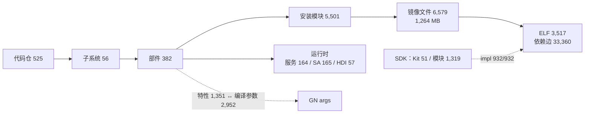

# oskm Skill 设计方案：纯 CLI 的 OpenHarmony 顶层架构 Skill

日期：2026-10-29（v2，**去掉 MCP**）
对象：把 `cli/oskm_cli/` 从 MCP server 改造成 CLI，并在其上做一个顶层架构 skill。
全部数字为实测，方法见 §10。**本文自足**——此前的三份分析文档
（`cli-vs-mcp.md` / `transport-stdio-vs-http.md` / `mcp-design.md`）
已随 MCP 一起删除，其中仍有效的结论与量化都收进了本文，
原件在 git 历史里（2026-10-29 之前）。

> **v1 → v2 的变化**：v1 推荐 CLI 与 MCP 并存，理由是 CLI 给不了
> 持久会话、多库 ATTACH、无转义的 `sql_query`。**后两条已被用户给出的方案解决**
> （多 `--db` 参数、SQL 走文件），本文已逐条验证可行（§3.5、§3.6）。
> 剩下的"持久会话"只值 0.2 秒，不足以留一套协议。**结论改为：去掉 MCP。**

---

## 0. 结论与影响面

### 0.1 去掉 MCP 的实际改动量

| | 行数 | 处置 |
|---|---:|---|
| `cli/oskm_cli/mcp/server.py` | 104 | **删除**。实测**无任何模块 import 它** |
| `cli/oskm_cli/mcp/session.py` | 126 | 保留。CLI 一次调用内仍要开库、挂第二个库 |
| `cli/oskm_cli/mcp/tools/`（14 个文件） | 1,432 | 保留。这是 CLI 的事实来源 |
| `cli/oskm_cli/mcp/security.py` | 109 | 保留 |
| `cli/oskm_cli/mcp/gitlink.py` | 94 | 保留 |
| `skills/ohos-design-architecture-evidence-query/references/spec/`（13 份） | 2,001 | 保留，成为 skill 的 Tier 2 |

**6,005 行里只删 104 行。** 因为 `tools/*.py` 本来就只是"声明 JSON Schema +
转调采集器的 `query.py`"，业务逻辑一行都不在协议层。

建议把 `cli/oskm_cli/mcp/` 改名为 `cli/oskm_cli/query/`——顶着一个不再说的协议的名字会误导。
代价是全仓 import 要改（`sed` 一遍 + 测试复跑），**不是必须，但建议一起做**，
否则半年后没人知道为什么查询层叫 mcp。

### 0.2 这次才真的省下 token

v1 说"skill 省不了常驻 token"，**那是在 MCP 保留的前提下成立的**。
MCP 去掉以后，50 个工具的 schema 不再进上下文：

| | 常驻成本 |
|---|---:|
| 现在：50 个 schema（14,130 字符）+ `AGENTS.md` 72 行 | ≈ **5,000 token** |
| 改造后：skill frontmatter 一段描述 | ≈ **170 token** |

**约 30 倍。** 这条现在站得住了，但仍然不是主要理由——
主要理由还是**可达性**（管道 / CI / 人直接用 / 任何有 shell 的宿主）。

### 0.3 失去什么

| 失去 | 代价 | 判断 |
|---|---|---|
| 持久会话 | 每次调用 0.19–0.23 s 解释器启动（实测） | 20 次调用约 4 s，**可接受** |
| Claude Desktop / opencode 等非 Bash 宿主 | 这些宿主用不了 oskm | **真实损失**。但本仓的使用形态一直是带 shell 的 Agent，且 MCP 实际从未挂载过（`mcpServers` 在任何配置文件里都不存在） |
| 协议层的参数校验 | argparse 等价替代（含 `enum` → `choices`，实测） | 平手 |

---

## 1. Skill 的定位

**回答"这个 OpenHarmony 产品长什么样"，不是 50 个工具的说明书。**

按工具组织，使用者得先知道有 `owner_of` 才能问"这文件是谁的"；
按**架构问题**组织，问什么就查什么，工具名是实现细节。

改造前的 `AGENTS.md` 已经在往这个方向走，但它常驻、手抄、而且**内容会错**——
它推荐过 `elf_dependencies(max_distance=3)`，实测是 90 秒 / 1.27 MB 的调用。
根因是那个工具把"闭包"做成了路径枚举（3,586 行只有 297 个不同节点，92% 重复），
已改为节点去重 + 内存 BFS，**0.01 秒 / 66 KB**，细节见
`query/tools/elf.py` 的 `elf_dependencies` 文档字符串与
`tests/test_elf_tools.py::TestDependencyClosure`。
Skill 要解决的正是"这类知识没地方放"。

### 1.1 不做什么

| 不做 | 为什么 |
|---|---|
| 构建 / 编译 | 那是 `ohbuild`、`ohhap` 的事 |
| 修改源码 | SDK 源码是运行时输入；只按 DB 给出的路径与 revision 读取证据，绝不写回 |
| 写数据 | 全部只读。写库只有 `oskm scan` 一条路 |
| 实时查设备 | 库是**一次扫描的快照**，不是在线状态 |

### 1.2 运行时输入

```
<runtime-root>/
  knowledge.db          # 唯一数据库
  interface/sdk-js/     # ArkTS API / Kit 声明源码
  interface/sdk_c/      # Native SDK 头文件源码
```

- 运行时不是三个数据库，而是一个统一 `knowledge.tar.gz`，解压后为**一个
  `knowledge.db` 加两套 SDK 源码**。安装不再从 Git 仓库拉取 SDK，也不要求
  Git/SDK 分支凭据；下载端点由本地环境提供。
- 在 OpenHarmony 源码根安装时，自动探测 `out/<product>/oskm/` 或
  `out/<abi>/<device>/oskm/` 下的源码 DB（布局只由 `product` 的相对路径决定），并复用 `interface/sdk-js`、
  `interface/sdk_c`；三者完整且 schema 兼容时复制安装，不联网、不移动源码。
  本地运行时不按日期自动刷新，显式 `install` 才会重新复制源码产物。
- DB 保存关系事实和证据位置；`sdk-js` 用来核对 ArkTS `source_path` 与实现 `.so`，
  `sdk_c` 用来核对 Native SDK `header_path`。
- 源码只读。DB 的 revision 和 `content_match=unverified` 说明快照可能漂移；
  缺失时报告 `SDK 源码缺失`，不要把“无法核对”说成“没有关系”。
- skill 不扫描、不重建 DB、不编译；初始化只负责安全解压归档并把固定目录结构就位。

---

## 2. 要回答的六类问题

规模来自 rk3568 全量扫描（11 个采集器，实测 78.9 s）：



| # | 架构问题 | 命令 | 实测规模 |
|---|---|---|---|
| 1 | 这个产品由什么构成 | `oskm arch overview` | 56 子系统 / 382 部件 / 1,264 MB |
| 2 | 某个文件从哪来 | `oskm arch trace <镜像路径>` | 5 步到 git URL（§3.4） |
| 3 | 改它会影响谁 | `oskm arch impact <路径\|部件>` | 依赖边 33,360 |
| 4 | 某个能力由谁实现 | `oskm arch provides <部件>` | SDK 侧 932/932 解析到唯一 ELF |
| 5 | 某个开关控制什么 | `oskm arch switch <参数名>` | 特性 1,351，命中 gn_arg 1,316 |
| 6 | 运行时长什么样 | `oskm arch runtime <部件\|服务>` | 164 进程托管 165 SA + 57 HDI |

> 写这份方案时顺手验证这六条路径，**当场发现四个工具从上线起就没成功过一次**：
> `search_gn_args` / `search_sas` / `search_hdis` / `get_hdi` 全抛
> `INTERNAL: ambiguous column name: scan_id`（WHERE 子句的列没带表别名，
> 而查询 JOIN 了 `components`）。前三个就写在 `AGENTS.md` 的「模糊搜索」一节里。
> **已修并补了逐工具冒烟测试**，见 §6。

---

## 3. CLI 设计

与现有 `oskm scan / list / scans / drop` 并列，新增四个子命令。

### 3.1 全局参数

```
--db PATH              库路径；缺省按 --product 推导 artifacts/<product>/knowledge.db
--product NAME         产品名
--scan-id N            快照 id，缺省取最新
--format json|table    默认 json
```

**不猜默认产品。** `artifacts/` 下有 5 个目录，但只有 `rk3568/` 放 knowledge.db，
其余四个（components / hdi / services / system-abilities）是**按域导出的 JSON**，
各自再分产品——目录布局很容易被误认成"5 个产品"。`scans` 表实际只有一行。

### 3.2 `oskm ask`：生成式，覆盖全部 50 个工具

先用一个 **34 行样机**验证过可行：把 `REGISTRY` 的 JSON Schema 翻成 argparse，
`--help` 来自 `description`，`choices` 来自 `enum`。样机当时就跑通了全部 50 个工具，
包括那天刚加的 `--component` 反查参数——没写一行针对它的代码。
**不手写子命令**——手写一份就是又一处会漂的副本（已经漂过四处）。

```bash
oskm ask --list                                      # 50 个工具，按模块分组
oskm ask get_component --name ace_engine
oskm ask list_arkts_modules --component ace_engine --limit 5
```

非标量参数实测只有 **6 个 / 130 个**（4 个工具）：

| 类型 | 个数 | 生成器 |
|---|---:|---|
| string / integer / boolean | 124 | `type=str/int` / `store_true` |
| array（`diff_scans.fields`、`aggregate.group_by`、`sql_query.params`） | 3 | `nargs='+'` |
| object（`list_entities.filters`/`.page`、`aggregate.filters`） | 3 | `type=json.loads` |

**95% 直接能生成，剩下 5% 多 6 行代码。**

### 3.3 `oskm arch`：复合命令，只编排不新增事实

`ask` 完备但扁平。架构问题常要串几步，每次让模型自己串既慢又容易串错。
加一组薄的复合命令，但**必须立规矩**，否则它会长成第二套会漂的 API：

1. **只能编排 `ask` 已有的工具，不得写新 SQL。** 新事实一律回采集器 / `query.py`。
2. **任何 `arch` 能答的，`ask` 也必须能答。** `arch` 是快捷方式，不是唯一入口。
3. **数量封顶 6 条**，一一对应 §2。想加第 7 条，先问它是不是真的架构级。

### 3.4 实测跑通的 `arch trace`

五步全部是现成工具，无一行新 SQL：

```
$ oskm arch trace system/lib/module/multimedia/libimage.z.so
1 owner_of        → image_framework | //foundation/multimedia/image_framework/…
2 get_component   → 子系统 multimedia | 仓 id 223
3 get_repo        → https://gitcode.com/openharmony/multimedia_image_framework/tree/33b2a0…
4 反查 SDK 接口   → 1 个：api/@ohos.multimedia.image
5 直接依赖        → 6 个
```

### 3.5 `oskm diff`：多个 `--db` 做跨库对比

v1 把 `diff_scans` 判为"CLI 做不到，留在 MCP"。**那个判断是错的**——
ATTACH 要的只是"同一个进程里开两个库"，而一次 CLI 调用本来就是一个进程。

**实测：单进程内 open A → attach B → diff，完全成立。** 用一个注入了差异的库验证
（删 2 个部件、改 1 个子系统的 `subsystem`）：

```
 open    {'scan_id': 1, 'product': 'rk3568'}
 attach  {'alias': 'b', 'tables': [... 20 张表 ...]}
 diff    entity=components  added 0  removed 2  changed 1
         removed: ["ace_engine", "image_framework"]
         changed: [{"key":"init","changes":[{"field":"subsystem",
                    "before":"startup","after":"changed"}]}]
```

**handler 一行都不用改。** CLI 形态：

```bash
oskm diff --db a.db --db b.db --entity components
oskm diff --db a.db --db b.db --entity gn_args --fields current_value
oskm diff --db a.db --scan-a 1 --scan-b 2 --entity components   # 同库两次扫描
```

`--db` 给两次就是跨库；给一次 + `--scan-a/--scan-b` 就是同库两快照。
CLI 内部做 open + attach(alias=`b`) + `diff_scans(db_b='b')`，对使用者不暴露 alias。

> 实现要点：第二个库必须**只读挂载**，且 attach 失败要给出清楚的错误
> （路径不存在 / schema 版本不符），不能让 SQLite 的原始报错透出来。

### 3.6 `oskm sql`：SQL 走文件，解决引号地狱

```bash
oskm sql --file query.sql
oskm sql --file query.sql --param ace_engine --param system
cat query.sql | oskm sql --file -          # 支持 stdin
oskm sql --sql "SELECT ..."                # 短查询仍可直接给
```

**验证时发现了一个真阻塞点并已修复。** `security.check_sql` 原来取
`sql.strip().split()[0]` 当第一个关键字——SQL 文件开头几乎总有一段说明注释，
于是拿到的是 `--`，任何带头注释的查询都被判 `NOT_READ_ONLY`：

```
$ oskm sql --file q.sql
error: NOT_READ_ONLY: first keyword: --
```

命令行里手写 SQL 碰不到这个，**一改成文件传递就天天碰到**。
已改为跳过开头的行注释与块注释再取关键字，并且**不放松校验**：
剥完之后第一个词仍须是 SELECT/WITH。

修复后这段真实的多行 SQL（4 个单引号、9 个换行、`%` 通配符、带头注释）跑通，返回 6 行：

```sql
-- 这种 SQL 直接写进 shell 就是引号地狱
SELECT c.subsystem, COUNT(*) AS parts,
       SUM(CASE WHEN c.name LIKE '%engine%' THEN 1 ELSE 0 END) AS engines
  FROM components c
 WHERE c.subsystem != 'thirdparty'
 GROUP BY c.subsystem HAVING parts > 8 ORDER BY parts DESC
```

新增 6 条测试盯住"跳过注释 ≠ 绕过只读校验"：
`-- SELECT\nDROP TABLE x` 和 `/* SELECT */ DELETE FROM x` 都必须照样拒绝。

### 3.7 session 的 10 个工具

| 工具 | CLI 形态 |
|---|---|
| `open_session` / `close_session` / `switch_session` / `list_sessions` | **消失**。一次调用一个会话，由 `--db` / `--scan-id` 表达 |
| `attach_secondary` / `detach_secondary` | **消失为参数**。由 `oskm diff` 的第二个 `--db` 隐式完成 |
| `diff_scans` | → `oskm diff`（§3.5） |
| `get_scan_info` / `list_scans` / `get_link_stats` | 照常出 |

10 个里 6 个不再是"工具"，而是 CLI 的参数——**这是去掉协议层最直接的收益**：
会话管理本来就是长驻进程的需求，不是领域概念。

> `ask` 仍保留这 6 个的直通形态（它们还在 `REGISTRY` 里），但 skill 不介绍，
> `--list` 把它们归到「内部」分组。**不删 registry 条目**，否则 `tools/` 层要动。

### 3.8 输出与退出码

| | 约定 | 理由 |
|---|---|---|
| 默认 | JSON | 要能 `\| jq`；管道是 CLI 的主要理由 |
| 人读 | `--format table` | 让人不经 Agent 也能用 |
| 退出码 | 0 正常 / 1 工具返回 error / 2 参数错 / 3 库打不开 | CI 门禁要能判 |
| 错误 | 原样输出 `{"error":{"code":…}}` 到 stderr | 沿用同一套错误码，不另造 |
| 截断 | `truncated`/`total` 原样透出 | 见 §5 第 5 条 |

---

## 4. 三层披露

| 层 | 内容 | 何时进上下文 | 体量 |
|---|---|---|---|
| **Tier 0** | frontmatter 的 `name` + `description` | **始终** | 实测草稿 166 字符 ≈ 170 token |
| **Tier 1** | `SKILL.md` 正文 | 命中触发词时 | 目标 ≤150 行 ≈ 2.5k token |
| **Tier 2** | `skills/ohos-design-architecture-evidence-query/references/spec/*.md`（13 份 66 KB）+ 生成的工具索引 | 模型按需 Read | 不常驻 |

落地位置——**skill 就是包本身**，不再另放一份。2026-11-12 起查询实现与 skill
是**两个独立产物**（见 [cli-skill-split.md](./cli-skill-split.md)）：

```
packages/oskm/cli/              ← 产物①：查询实现 oskm-cli（相关文件全在 cli/ 内）
  oskm_cli/cli.py  database.py  query/
  scripts/build_cli.py           → cli/dist/oskm-cli.pyz（固定名）+ SHA256SUMS
  tests/  dist/  README.md

packages/oskm/skills/ohos-design-architecture-evidence-query/   ← 产物②
  SKILL.md                      Tier 1
  bootstrap.py                  唯一入口
  oskm_runtime/                 装配层：下载 / 安装 / CLI 定位 / 状态
  references/tools.md           生成的工具索引
  references/usage.md           完整 CLI 用法
  references/spec/              Tier 2
  scripts/build_skill.py        → skills/…/dist/ohos-design-architecture-evidence-query-<v>.tar.gz

packages/oskm/oskm_schema/      ← 中立的表结构定义，**只打进 pyz，不进 skill 归档**

ohos-design-architecture-evidence-query/  ← build_skill.py 生成的发布根目录
  SKILL.md  README.md  bootstrap.py
  oskm_runtime/  references/  examples/  evals/

KnowledgeBase/.claude/skills/ohos-design-architecture-evidence-query
  -> ../../packages/oskm/skills/ohos-design-architecture-evidence-query   （软链）
```

软链而不是复制：复制就会有两份 SKILL.md 慢慢走样。本仓靠软链让 Claude Code
发现源码版本；发布时 `python3 cli/scripts/build_cli.py` 与
`python3 skills/ohos-design-architecture-evidence-query/scripts/build_skill.py`
各写各的 `dist/`。**两个产物互不依赖**，构建先后顺序无所谓
（`cli_pin.json` 版本锁已于 2026-11-12 删除：CLI 与 `knowledge.db` 同类，
固定文件名 `oskm-cli.pyz`、不记版本）。
安装父目录由宿主 AI 工具决定：
本仓 Claude Code 项目级软链位于
`.claude/skills/ohos-design-architecture-evidence-query/`，Claude Code 用户级位于
`~/.claude/skills/ohos-design-architecture-evidence-query/`，Codex 用户级位于
`${CODEX_HOME:-$HOME/.codex}/skills/ohos-design-architecture-evidence-query/`。
运行时数据仍使用独立的 `~/.oskm/`。

**发布包可以脱离 `packages/oskm/` 单独运行**，但需要单独取得 CLI：
`cli/oskm_cli/` 不 import `oskm`，
查询实体时使用内联的只读 `cli/oskm_cli/query/readonly_session.py`。包根下没有同名
采集器模块 `oskm/`，也没有 `collectors/`；`scan` 仍只在源码仓提供。查询入口统一为
`python3 bootstrap.py …`，运行时检查为 `python3 bootstrap.py doctor`。
运行时只下载一个 `knowledge.tar.gz`，不要求 Git 或 SDK 分支凭据。下载方式由
`OSKM_DOWNLOAD_SOURCE` 选择：`OPENHARMONY_CI`（默认）向
`OSKM_DOWNLOAD_ENDPOINT` POST，component 固定为 `dayu600_7885_ai`；
`INTERNAL_CI` 请求 `$OSKM_DOWNLOAD_ENDPOINT/<YYYYMMDD>`。真实 `.env`
不进入仓库。

入库字段遵循 `ohos-<stage>-<domain>-<capability>` 命名；顶层只放 `name` 与
`description`，作者和版本放进 `metadata`：

```yaml
name: ohos-design-architecture-evidence-query
description: "当用户询问 OpenHarmony 产品顶层架构证据时使用：产品由哪些子系统、
  部件和进程构成，镜像文件属于哪个部件或代码仓，修改一个库会影响谁，
  SysCap/SDK 接口由谁实现，GN 编译开关控制哪些特性，或原生库对应哪些 SDK 头文件。
  只读 knowledge.db，并用 SDK 源码核对声明和头文件证据；不扫描、不编译。
  命令：python3 bootstrap.py（在 skill 目录内执行）。"
metadata:
  author: "oskm team"
  version: "3.0.0"
```

`description` 是 Tier 0 的**全部**，所以写的是**问题**（"属于哪个部件"）
而不是能力名词（"知识库查询"），并明确运行时输入是一个 DB 加两套源码。
这比 v1 长，但必须避免把 `sdk-js` / `sdk_c` 误认成另外两个 DB。

Tier 1 的 150 行怎么花：

```
 18 行  这是什么 / 一个 DB + 两套 SDK / 缺库或缺源码怎么办
 15 行  分层模型
 60 行  六类问题 × 每类一条可直接粘贴的命令
 40 行  容易误读的（§5）
 15 行  更深入读哪份 spec
 10 行  边界：不做什么
```

**Tier 2 不复制，只引用。** 66 KB 的 spec 抄一份就是两份会分叉的规格。

---

## 5. SKILL.md 的「容易误读的」

这是 skill 最该承载的内容：**schema 的 description 塞不下，但不说就一定会误判。**
每条都有实测出处。

| # | 陷阱 | 正确读法 |
|---|---|---|
| 1 | **`degraded` 不等于失败** | 11 个采集器里 4 个 degraded（arkts/components/services/hdi）。arkts 的原因只有一条：1 份声明文件非 UTF-8。数据是全的 |
| 2 | **空值有好几种含义** | SDK 模块没有实现 `.so`：`type_only` 本就不需要、`arkts_builtin` 由运行时提供、`unknown` 才是真不知道 |
| 3 | **引用条数 ≠ 对端数量** | AbilityKit 的 188 条 import 只指向 104 个模块 |
| 4 | **成员关系两条来路且会不一致** | 全库 1,273 对关系里 662 对只有 `@kit` 标签没被入口 import。**不一致是正常的** |
| 5 | **依赖闭包从 1 跳起** | `libace_engine_pa_ark.z.so`：1 跳 27、2 跳 169、3 跳 297、全闭包 387。默认返回 200 个，`truncated=true` 时看 `total` |
| 6 | **`out_of_scope` 不是缺陷** | 未解析引用有四种原因，指向外部包本来就不该解析 |
| 7 | **实现路径有架构根** | 采集时按本次 `cpu_arch` 归一（默认 `arm64`）：`arm` 为 `system/lib/…`，`arm64` 为 `system/lib64/…`；ArkUI 优先采用唯一安装证据，`arkts_links` 按完整路径精确关联 |
| 8 | **快照不是现状** | git 提交号是扫描当时的，`content_match` 恒为 `unverified` |

第 1、5、8 条尤其重要——**最容易让人得出"数据有问题"的错误结论**。

---

## 6. 防漂移：生成 + 门禁

工具清单已经在四份文档里各漂过一次（43/43/49/49，真值 50）。
**再手抄一份进 SKILL.md 只是把问题搬个地方。**

| 内容 | 门禁 | 状态 |
|---|---|---|
| **每个工具至少被真调一次，不许 `INTERNAL`** | `test_every_tool_runs.py` | ✅ 已落地 |
| **带注释的 SQL 文件能跑且不绕过只读校验** | `test_security.py` 新增 6 条 | ✅ 已落地 |
| 文档里的工具数 / 逐模块表 / 工具名 | `test_docs_match_registry.py` | ✅ 已落地 |
| skill `references/tools.md` 与 `--list` 一致 | 重新生成后比对 | 已完成 |
| SKILL.md 里的每条命令 | **逐条真跑**，退出码非 0 即失败 | 待做 |
| SKILL.md 里的规模数字 | 对真库复算 | 待做 |

**第一条是写这份方案时临时加的，因为它当场抓到四个死工具。**
原来只有 32 条 e2e 测试，覆盖「20 个典型提问」——挑的都是能答得漂亮的，
"列在文档里但从没人调过"的正好漏在缝里。手工挨个探时本文还漏了 `get_hdi`，
是这份名单抓出来的。名单里每个跳过项都要写理由，**不写理由就是漏测**。

"逐条真跑"同样关键：**门禁能校工具名和计数，校不了"这个建议本身是坏的"。**
`max_distance=3` 那条错误建议是实跑才发现的。每条命令跑一遍，
顺带记耗时与响应大小，超标就报。

---

## 7. 分期

| 期 | 内容 | 状态 |
|---|---|---|
| **1** | `oskm ask` 生成式 CLI（含 6 个非标量参数）、`--list`、`--format`、退出码 | ✅ 50 个工具全可调；`--group_by subsystem` 返回 56 组；枚举错值被 argparse 拒 |
| **2** | `oskm diff`（多 `--db`）、`oskm sql --file` | ✅ 跨库 diff 检出注入的 2 删 1 改；带注释多行 SQL 文件跑通 |
| **3** | `oskm arch` 六条复合命令 | ✅ 六条全出真数据；`arch trace` 五跳通到 git URL |
| **4** | 删 `server.py`；`cli/oskm_cli/mcp/` → `cli/oskm_cli/query/` | ✅ 代码里无残留 mcp 引用 |
| **5** | `SKILL.md` + skill `references/tools.md` 生成 | ✅ 138 行（预算 150）；索引由 `ask --list --markdown` 生成 |
| **6** | 门禁补齐；`AGENTS.md` 瘦成一条指针 | ✅ 13 条 skill 门禁，6 条反证全部抓到；AGENTS.md 72 → 23 行 |

落地结果：查询层测试 **111 条**（原 74 + CLI 24 + skill 13），采集器 **262 条**，全绿。

实施中偏离方案的两处，都记在这：

1. **退出码没按方案写的 `0/1/2/3`**，改用 `oskm/cli.py` 已有的口径
   `0/2/3/5`——同一个 CLI 里两套退出码才是真的坑。
2. **`arch` 的四条命令按错误的参数名写了一遍才发现**：`component_*` 这批工具
   收的是 `component_id` 不是名字，`get_component` 返回的 `repo` 是 id 不是名字，
   `syscaps` 项的键是 `name` 不是 `value`。照文档推参数会错，**必须真调一次看返回**。

**第 6 期必须做反证。** 上一轮加门禁时第一版正则写的是 `个工具`，
而文案是"50 个**只读**工具"，整条断言空转——是注入错值才发现的。
本轮的两个新门禁都做了反证：逐个退回三处 SQL 修复、退回 `_first_keyword`，
确认测试都变红。**只看"测试通过"会放过空转的断言。**

---

## 8. 风险

| 风险 | 判断 | 对策 |
|---|---|---|
| `arch` 长成第二套会漂的 API | **真实** | §3.3 三条硬约束，封顶 6 条 |
| 丢掉非 Bash 宿主 | **真实但已接受** | MCP 实际从未挂载过；真要回去，`tools/` 层没动，重写 `server.py` 约 104 行 |
| `oskm sql` 的只读校验被绕过 | 中 | 已加 6 条针对"注释伪装"的测试；但**它本来就不是硬边界**——有 shell 就能直接 `python3 -c "import sqlite3"` 写库 |
| 跨库 diff 的 schema 不一致 | 中 | attach 时校验 schema 版本，不一致明确报错 |
| 每次调用 0.2 s 启动 | 实测 | 可接受；瓶颈是 `framework.discover()`（0.12 s），真嫌慢可延迟注册 |
| SKILL.md 超 150 行 | 很可能 | 超了往 Tier 2 挪，不往正文堆 |

---

## 9. 不做的事

1. **不手写 50 个子命令**（第五处漂移源）。
2. **不把 spec 复制进 skill**（66 KB × 2 = 两份会分叉的规格）。
3. **不在 `arch` 里写新 SQL**。新事实回采集器。
4. **不删 `REGISTRY` 里的 session 工具**，只是不在 skill 里介绍（§3.7）。
5. **不靠"省 token"单独论证这个方案**——30 倍是真的，但可达性才是主因。

---

## 10. 测量方法

- **删除面**：`grep -R -n "import server\|from .server\|mcp.server"` 确认
  `server.py` 无人依赖；`wc -l` 逐文件统计去留
- **参数类型分布**：遍历 `export()` 的 `inputSchema.properties` 按 `type` 计数，
  并列出全部非标量项——**先量再设计**，"数组参数很麻烦"的印象不量就会否掉生成式方案
- **跨库 diff**：复制真库后**注入已知差异**（删 2 个部件、改 1 个 `subsystem`），
  再单进程 open+attach+diff，核对检出的正是注入的那几条。
  只跑通不注入差异，证明不了它真的在比对
- **SQL 文件**：用一段**真实含 4 个单引号、9 个换行、`%` 通配符、带头注释**的
  多行 SQL 走完整路径；再对 `check_sql` 单独列 11 种开头形态逐一判定，
  确认"跳过注释"没有变成绕过只读校验的口子
- **规模数字**：对 `artifacts/rk3568/knowledge.db` 逐表 `count(*)`；
  子系统数走真实工具 `aggregate(group_by=['subsystem'])`，不另写 SQL
- **反证**：每加一条门禁，都退回对应的修复确认测试变红——
  **只看通过会放过空转的断言**
