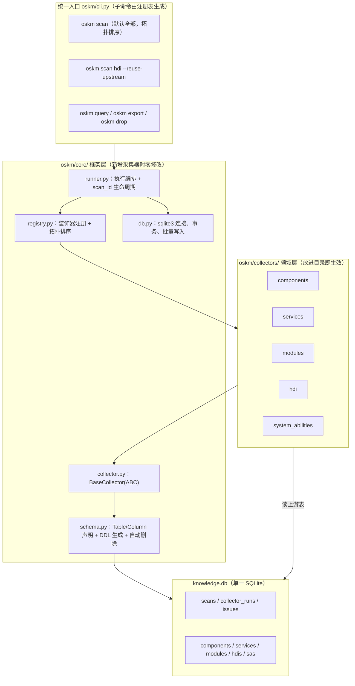

# 参照 SystemPulse 重构 oskm：SQLite 化 + 注册表架构可行性分析与优化方案

日期：2026-10-17；状态：**可行性分析与方案，待判断后实施**。本文基于对 `code/SystemPulse/collector`（`collector_core/` 四个核心模块 2754 行 + sample collector）的逐行阅读，与 oskm 当前代码（4503 行、5 个采集器、109 个测试全绿）的对照评估。

本方案已分四期实施完毕，当前架构见第 4 节目标架构与第 8 节实施补充。（两份前置设计文档 `collector-base-class-design.md`、`collector-registry-session-design.md` 描述的是已被本次改造整体替换的框架，已删除，内容可从 git 历史取回。）

## 1. 参考架构解读：SystemPulse 做对了什么

| 机制 | SystemPulse 实现 | 评价 |
| --- | --- | --- |
| **强制注册** | `@collector(name=, description=, version=, author=)` 装饰器写入 `_collector_name` 等类属性 | **值得照搬**。注册是显式动作，不是靠文档约定 |
| **强制接口** | `BaseCollector(ABC)` + `@abstractmethod collect()` / `delete_by_task_id()` | **值得照搬，且是本次改造最核心的收益**（理由见第 2 节） |
| **模板方法** | `do_collect()` 包裹 `collect()`，统一处理计时、日志、异常兜底、状态推导 | 值得照搬，oskm 的 `BaseCollector.scan()` 已是同构设计 |
| **自动发现** | `CollectorLoader` 遍历 `collectors/` 目录 | 思路对，**但实现要改**（见下） |
| **统一结果** | 单一可变 `CollectorResult{status, data, errors, warnings}` | **不适合照搬**，oskm 的 issues/degraded 模型严格得多（见第 5.4 节） |
| **DB 承载跨采集器数据流** | 无依赖机制，下游用 `task_id` 查上游表 | **值得照搬**，正是本次要解决 9 次重复扫描的答案 |
| **task_id 贯穿** | 每张表带 `task_id` FK + `ON DELETE CASCADE` | 值得照搬，对应本次的 `scan_id` |
| **持久化 IoC** | `result.persist_to(model_class, ...)` 回调模型的 `_create_from_result()` | 思路对，但 oskm 可以做得更省（见下） |

### 1.1 两处不建议照搬的实现细节

**(a) `CollectorLoader` 用"读文件找 `@collector(` 字符串"来判断是不是采集器文件**：

```python
def _is_collector_file(self, file_path: str) -> bool:
    with open(file_path, 'r', encoding='utf-8') as f:
        for i, line in enumerate(f):
            if i >= 1000: break
            if '@collector(' in line or '@collector ' in line:
                return True
```

这是脆弱的文本嗅探：注释或字符串里出现 `@collector(` 会误判，装饰器换行写（`@collector(\n    name=...`）靠前 1000 行限制勉强兜住，重命名导入（`from collector import collector as reg`）直接漏判。oskm 应改用 `pkgutil.iter_modules` 包扫描 + 装饰器真实执行注册，效果相同但没有这些失效模式。

**(b) 每个采集器手写 `delete_by_task_id()`**：sample 的 filestat 为了删**一张表**写了约 70 行（含 dry-run 分支、`no such table` 容错、统计字典组装）。oskm 应改为**声明式表定义 + 框架自动生成删除**：采集器声明 `TABLES`，框架按依赖顺序倒序生成 `DELETE FROM <t> WHERE scan_id = ?`。采集器零代码，且不会漏表。

## 3. 已确认的四个决策

| # | 决策 | 影响 |
| --- | --- | --- |
| 1 | **stdlib `sqlite3` + 轻量 schema 层** | 保持零第三方依赖；需自写约 250 行表定义/DDL/查询封装 |
| 2 | **依赖通过数据库传递**（彻底照搬 SystemPulse） | `ownership.py`/`linking.py` 改写为 SQL 查询；`load_components()` 删除；9 次扫描降为 5 次 |
| 3 | **查询层完整改为 SQL** | 5 个 `<Name>Query` + `core/query.py` + `core/base_query.py` 重写；跨域导航 = JOIN |
| 4 | **支持多快照，每行带 `scan_id`** | 新增 `scans`/`collector_runs` 表；每个采集器声明 `TABLES`，框架自动生成按 `scan_id` 删除 |

## 4. 目标架构



### 4.1 框架骨架表

```sql
CREATE TABLE scans (
    id             INTEGER PRIMARY KEY AUTOINCREMENT,
    product        TEXT NOT NULL,
    cpu_arch       TEXT NOT NULL DEFAULT 'arm64',
    workspace_root TEXT NOT NULL,
    started_at     TEXT NOT NULL,
    finished_at    TEXT
);

CREATE TABLE collector_runs (          -- 取代各领域的 snapshot 字典
    scan_id        INTEGER NOT NULL REFERENCES scans(id) ON DELETE CASCADE,
    collector      TEXT NOT NULL,
    schema_version TEXT NOT NULL,
    status         TEXT NOT NULL CHECK (status IN ('complete','degraded','failed')),
    scope          TEXT,               -- JSON
    record_count   INTEGER NOT NULL,
    error          TEXT,               -- status='failed' 时的原因
    PRIMARY KEY (scan_id, collector)
);

CREATE TABLE issues (                  -- 所有领域、所有质量问题的唯一去处
    scan_id   INTEGER NOT NULL REFERENCES scans(id) ON DELETE CASCADE,
    collector TEXT NOT NULL,
    path      TEXT NOT NULL,
    pointer   TEXT NOT NULL DEFAULT '',
    code      TEXT NOT NULL,
    severity  TEXT NOT NULL DEFAULT 'error' CHECK (severity IN ('info','warning','error')),
    component TEXT NOT NULL DEFAULT '',
    advisory  INTEGER NOT NULL DEFAULT 0 CHECK (advisory IN (0,1)),
    details   TEXT,                    -- JSON
    UNIQUE (scan_id, collector, component, path, pointer, code)
);
```

`collector_runs` **不是 `scans` 的冗余**：`scans` 记录"一次扫描"（产品、`cpu_arch`、工作区、起止时间），`collector_runs` 记录"这次扫描里每个采集器各自的结局"。`cpu_arch` 是持久化快照元数据并默认 `arm64`。`collector_runs` 承载着 `scans` 表达不了的状态——依赖方必须区分的三种情况（**没选中** / **跑了但失败** / **正常跑完**）只存在于这里，`Upstream.ran()/failed()/status()`、`session.collectors/status`、`export.snapshot()`、`--reuse-upstream` 共 6 处在读它。但其中的 `started_at`/`finished_at` 是只写不读的真冗余，已删除：**时间是扫描的属性，只在 `scans` 里记一次**。

`advisory` 是**唯一的质量模型**所需的第二个维度：`0` = 扫描没读全/读懂（让快照 `degraded`、让 `inventory_complete()` 为假），`1` = 读得好好的但数据本身可疑（两者都不影响，只参与 `--fail-on`）。早先这两类走两套机制——前者进 `issues`，后者由各领域 `analysis/*.py` 在 CLI 时现算、只有数组下标、不落库——而 components 的 `SYSCAP_DUPLICATE` / `INNERAPI_EXTERNAL_NAME_CONFLICT` 本就是后者却进了 `issues`，界线已经被实践打破。现在合并为一张表加一个标志：全部持久化、全部带 `path`+`pointer`+`details`，消费者 `WHERE advisory = 0/1` 自行区分。

`issues` 表的 `UNIQUE` 约束**就是** `BaseContext._issue_key()` 的去重逻辑——第 2 节里 `modules` 与其余四领域排序约定不一致的问题，在这里被数据库约束一次性消灭（排序变成查询时的 `ORDER BY`，不再是产物的一部分，`ISSUES_ORDER` 这类校验整体消失）。`severity` 也在此统一：components/modules 本来就有，services/hdi/sa 默认 `'error'`。

### 4.2 领域表：`record` 原始全集 + 投射列

oskm 的核心契约是"原样保留声明"，不能全关系化。**统一原则：`record` 是原始全集，部分关键字段被提取成列，只是为了更高性能的访问。**

- `record` = **加载原始文件时该实体自己的那一段声明，不多不少**。services 是 cfg 里 `services[]` 的那个对象，sas 是 profile 里 `systemability[]` 的那个对象，hdis 是 HCB 里那个设备节点，components 是 bundle.json 里的 `component` 对象。扫描器推导出来的东西（文件路径、`executable`/`args` 拆分、`type` 分类、`label`、宿主、归属）**都不写进 `record`**。
- 列 = 对 `record` 的**投射**，不是搬运。原值放不进列（类型不符、整数超 8 字节）时列留 `NULL`，`record` 里的值依然精确。所以列可以随时增删而不损失任何信息。
- 发布记录 = 导出时由各领域的纯函数 `make_record()` 从 `record` + 派生列**重新生成**，与扫描当场产出的结果逐字节一致。

```sql
CREATE TABLE services (
    id             INTEGER PRIMARY KEY,    -- 代理键，供下游表外键引用
    scan_id        INTEGER NOT NULL REFERENCES scans(id) ON DELETE CASCADE,
    position       INTEGER NOT NULL,       -- 保持现有"数组位置即身份"语义
    cfg            TEXT NOT NULL,          -- 以下皆为 record 的投射
    name           TEXT,
    type           TEXT,
    executable     TEXT,
    uid            TEXT,
    start_mode     TEXT,
    ondemand       INTEGER,
    label          TEXT,
    args           TEXT,                   -- JSON
    gid            TEXT,                   -- JSON
    component_id   INTEGER REFERENCES components(id) ON DELETE CASCADE,  -- 归属外键
    record         TEXT NOT NULL,          -- cfg 里该服务的原始声明（含 Decimal 原文）
    UNIQUE (scan_id, position)
);
CREATE INDEX idx_services_component ON services(scan_id, component_id);
```

注意归属字段从当前的内嵌 `{name, subsystem, manifest}` 字典**规范化成 `component_id` 外键**——`subsystem`/`manifest` 不再冗余存储，查询时 JOIN 取。实施时每张领域表都加了 `id` 代理主键（rowid 别名），跨表引用统一走 id 而非业务键，由数据库强制引用完整性。

rk3568 实测：services 164 / hdi 57 / sas 165 共 386 条，`record` 列与独立重新解析源文件所得的声明**逐条相同**，发布记录与改造前的产物除归属形状（`part`/`subsystem` → `component{}`）外完全一致。

### 4.3 `BaseCollector`：强制 ABC

```python
class BaseCollector(ABC):
    NAME: str                      # 注册名、CLI 子命令、collector_runs.collector
    DEPENDS_ON: tuple[str, ...] = ()
    SCHEMA_VERSION: str
    TABLES: tuple[Table, ...]      # 声明式表定义；框架据此建表并自动生成按 scan_id 删除

    @abstractmethod
    def collect(self, ctx: ScanContext) -> None:
        """读源码树 + 通过 ctx.upstream 读上游表 → ctx.emit(table, row) / ctx.issue(...)。
        不返回值；状态、计时、异常兜底、事务提交由框架的 run() 模板方法负责。"""
```

与 SystemPulse 的差异（都是改进）：

- `delete_by_scan_id` **不是**抽象方法，由框架从 `TABLES` 自动生成——省掉 SystemPulse 里每个采集器约 70 行的手写删除样板，且不会漏表。
- 保留 oskm 的 `issue()`/`degraded()` 质量模型，不采用 `errors`/`warnings` 字符串列表。
- 不引入线程任务管理（`start_task`/`stop_task`）：oskm 的依赖图是线性的，扫描是同步的，现有的 `cancelled` 回调已足够。

注册与自动发现：

```python
# oskm/core/registry.py
_COLLECTORS = {}
def register(cls):
    _COLLECTORS[cls.NAME] = cls
    return cls
def resolve_order(selected): ...     # 拓扑排序 + 环检测

# oskm/collectors/__init__.py —— 唯一一处"框架感知领域"的代码，但不枚举任何领域名
for info in pkgutil.iter_modules(__path__):
    if info.ispkg:
        importlib.import_module(f'{__name__}.{info.name}.collector')
```

### 4.4 依赖通过数据库传递

```python
@register
class HDICollector(BaseCollector):
    NAME = 'hdi'
    DEPENDS_ON = ('services', 'components')
    SCHEMA_VERSION = '3.0.0'
    TABLES = (HDIS, )

    def collect(self, ctx):
        # 上游不再是内存对象，而是同一个 scan_id 下已经写好的表
        components = ctx.upstream.table('components')     # 只读视图，自动按 scan_id 过滤
        services   = ctx.upstream.table('services')
        ...
```

`components/dependency.py:load_components()` 整个删除；`hdi/linking.py`、`system_abilities/linking.py` 里写死的 `scan_services(...)` 删除，只保留各自的匹配逻辑（`host_argument` / `profile_argument`）改成对 `services` 表的查询。

这同时解锁了**单领域重扫**：

```
oskm scan                          # 全量：5 个采集器各跑一次
oskm scan hdi --reuse-upstream     # 只重扫 hdi，复用库里已有的 components/services
```

## 5. 可行性逐项评估

### 5.1 直接可行（低风险）

| 项 | 说明 |
| --- | --- |
| 注册表 + 自动发现 | `pkgutil` 包扫描，约 60 行，无技术难点 |
| 拓扑排序 + 环检测 | 依赖图只有 5 个节点，约 25 行 |
| `scans`/`collector_runs`/`issues` 骨架表 | 纯 DDL |
| 声明式 `TABLES` + 自动 DDL + 自动删除 | 约 120 行；比 SystemPulse 的手写删除更省 |
| 统一 CLI 子命令生成 | 已有 `core/cli.py` 的经验，改成遍历注册表 |
| 依赖改为读表 | 逻辑等价替换，`ownership`/`linking` 的**匹配算法本身不变**，只换数据来源 |

### 5.2 需要重写但路径清楚（中风险）

| 项 | 工作量 | 说明 |
| --- | --- | --- |
| 5 个 `query.py` 改 SQL | 约 370 行重写 | 过滤/分页/聚合换成 `WHERE`/`LIMIT`/`GROUP BY`；跨域导航换成 `JOIN`，上一版方案里要自建的 join 索引层直接不需要 |
| `core/query.py` 谓词层 | 128 行，大部分删除 | `equal`/`matches`/`numeric_key`/`paginate`/游标编解码被 SQL 取代；**但 `at_pointer` 要保留**（用于 `record` JSON 列内的嵌套字段过滤，见 5.3） |
| 5 个 `validation.py` | 约 420 行，大幅缩减 | 结构校验被表约束（`NOT NULL`/`CHECK`/`FK`/`UNIQUE`）取代；只需保留无法用 SQL 表达的形状校验（`relative_path()`、JSON Pointer 合法性） |
| `persistence/` | 110 行重写 | 原子替换 + 复读校验的 JSON 逻辑，换成 SQLite 事务 |
| `modules` 采集器 | 1271 行，改造最大 | 它是唯一完全没进框架的领域，要同时做"接入框架"和"SQLite 化" |

### 5.3 必须注意的技术陷阱

**(a) Decimal 精度必须保真。** oskm 用 `parse_json(parse_float=Decimal)` 保留 JSON 数字字面量的精确值，`canonical()` 原样回写。测试里有真实用例：

```python
extra=Decimal('1.1234567890123456789')     # oskm/tests/test_components.py:79，19 位有效数字
```

SQLite 的 `REAL` 是 IEEE 754 双精度（约 15–17 位有效数字），**存进 REAL 列会静默丢精度**。约束：一等字段里凡是可能出现非整数的，一律不建 `REAL` 列，统一留在 `record` JSON TEXT 列里（或声明为 JSON 列，保留原文）；需要数值比较时用 `CAST`，但不作为存储形态。这一条要写进框架文档并加测试。

**(b) 产物不再字节可复现。** 当前 JSON 产物是 `canonical()` 确定性编码，同一输入两次扫描字节一致（`tests` 里有"重复 scan 产物不变"的断言）。SQLite 文件受页分配、`AUTOINCREMENT` 计数、时间戳影响，**不可能字节可复现**。缓解：提供 `oskm export --format json` 从库里导出确定性 JSON 用于 diff/回归，把"可复现"从存储层移到导出层。

**(c) `scan_id` 的并发与中断语义。** 多快照意味着一次扫描中途失败会留下半完成的 `scan_id`。需要约定：`scans.finished_at IS NULL` 即未完成，查询默认只看已完成快照，并提供 `oskm drop --scan-id N` 清理。

**(d) `ON DELETE CASCADE` 在 SQLite 默认不生效**，必须每个连接 `PRAGMA foreign_keys = ON`。这是 SQLite 的经典坑，框架的连接工厂里要统一设置。

### 5.4 建议**不**照搬的部分

| SystemPulse 的做法 | 建议 | 理由 |
| --- | --- | --- |
| `CollectorResult{status, data: dict, errors: [str], warnings: [str]}` | **保留 oskm 的 issues/degraded 模型** | oskm 的问题有 `path`/`pointer`/`code`/`severity`/`details` 结构化字段与去重键，能精确定位到文件与 JSON 位置；退化成字符串列表是重大倒退 |
| `_is_collector_file` 文本嗅探 | 改 `pkgutil` 包扫描 | 见 1.1(a) |
| 每采集器手写 `delete_by_task_id` | 框架从 `TABLES` 自动生成 | 见 1.1(b) |
| 线程任务管理 `start_task`/`stop_task` | 不引入 | oskm 依赖图线性、同步执行，现有 `cancelled` 回调已够 |
| 日志管理器（406 行 `log_manager.py`） | 不引入 | oskm 用 `on_progress`/`on_diagnostic` 回调把输出控制权交给调用方，更适合库形态 |

## 6. 精简量化

| 项目 | 当前 | 改造后 | 变化 |
| --- | --- | --- | --- |
| 跑完五个领域的 collector 执行次数 | **9 次** | **5 次** | -44% |
| 单领域重扫（复用上游） | 不支持 | `--reuse-upstream` | 新能力 |
| `<Name>ScanRequest` | 5 个类 | 1 个 `ScanRequest` | -4 类 |
| `<Name>Limits` | 5 个类 / 20+ 字段 | 1 个 `ScanLimits` | -4 类 |
| `<Name>Result` + `AggregatePage` | 9 个类 | 0（结果即表） | -9 类 |
| `api.py` / `cli.py`（per-domain） | 10 个文件 | 0 | -10 文件 |
| 包根 `scan_*.py` | 5 个 | 1 个统一入口 | -4 文件 |
| `query.py`（per-domain） | 5 个 / 约 370 行 | 5 个 / 约 150 行（SQL） | 约 -220 行 |
| `validation.py`（per-domain） | 5 个 / 约 420 行 | 约 150 行（表约束承担大部分） | 约 -270 行 |
| `core/query.py` + `base_query.py` | 157 行 | 约 30 行（保留 `at_pointer`） | 约 -127 行 |
| `components/dependency.py` + 两处 `linking` 嵌套扫描 | 约 55 行 | 0 | -55 行 |
| JSON Schema 文件 | 5 份 | 0（DDL 即 schema） | -5 文件 |
| 新增采集器需要修改的框架文件 | 3 处（persistence）+ 新建 api/cli/scan 脚本 | **0 处** | — |
| 新增采集器可以绕过框架 | **可以**（modules 已证明） | **不可以**（ABC 强制） | — |

新增框架代码：`registry.py`（约 60 行）、`runner.py`（约 130 行）、`schema.py`（约 120 行）、`db.py`（约 100 行）、统一 `cli.py`（约 110 行）≈ 520 行。

## 7. 风险与不可逆变更

1. **JSON 产物消失。** 五个 `*.json` 与五份 `schemas/*.json` 不再产出。缓解见 5.3(b) 的 `oskm export`。
2. **公开 API 全部改变。** 五个 `scan_<name>()`、五个 `scan_*.py`、五个 per-domain `cli.py` 移除。
3. **测试影响面大。** 109 个测试里，查询/游标/过滤/聚合相关约 11 个、校验相关约 9 个、持久化相关约 3 个、CLI/退出码相关约 11 个——**约 34 个（31%）需要重写**，其余的发现/解析/归属类测试主体逻辑可保留，但 fixture 与断言要适配新的结果形态。5 个 `verify_*_rk3568.py` 验收脚本全部要改。
4. **归属字段规范化。** `record['component']` 从内嵌 `{name, subsystem, manifest}` 变成 `component_id` 外键 + JOIN。读取时重建为原形状，所以发布记录的形状不变。
5. **`modules` 采集器需要较大改造**（1271 行，且当前完全在框架之外）。
6. **不可字节复现**（见 5.3(b)）。

## 8. 2026-10-19 实施补充

上文的“5 个采集器”是方案撰写时的历史规模，不代表当前注册表。当前实际拓扑为：

```text
repos → components → args → install_modules → component_links → services → hdi → sas → elf_modules
```

原 legacy `modules` JSON 扫描器已删除，避免与 `install_modules` 重复解析 SMI。其独有物理 ELF 分析迁移为 `elf_modules`：

- 上游只读 SQLite 中的 `component_links` / `services` / `hdi` / `sas` 及 `install_targets`，不重扫 `system_module_info.json`；
- 只使用标准库内置 ELF dynamic table parser，不保留 LIEF 可选依赖；
- 直接边落 `elf_module_dependencies`，间接闭包查询时计算；
- `elf_modules` 是唯一新增 ELF 模块域，`install_modules` 仍是安装清单唯一权威。
