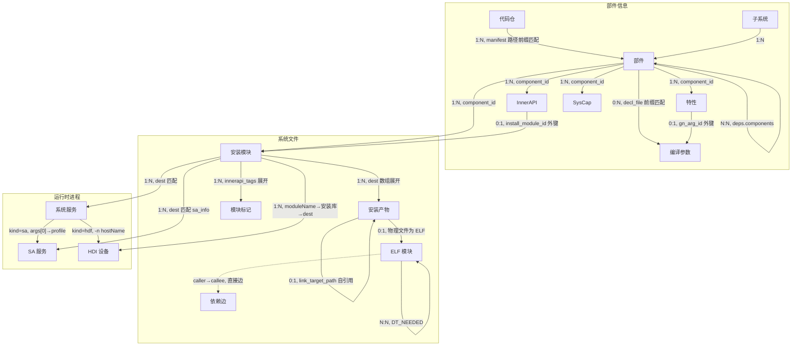

# 统一模型：采集器结果与跨域关系

日期：2026-10-20  
状态：**交付文档**，反映当前代码实际状态。

## 1. 采集器拓扑序

```
repos → components → args → install_modules → component_links → services → hdi → sas → elf_modules
```

| 采集器 | DEPENDS_ON | 数据来源 | 表 |
|--------|-----------|----------|-----|
| repos | () | `.repo/manifests/default.xml`（或 `.repo/manifest.xml` symlink 目标）+ 每仓 `.git/HEAD`、`.git/config` | `repos` |
| components | repos | `{build_root}/build_configs/parts_info/components.json` + 源码 `bundle.json`/`ohos.build` | `components`, `innerapis`, `features`, `syscaps` |
| args | components | `gn args {build_root} --list --json`（prebuilt gn） | `gn_args` |
| install_modules | components | `{build_root}/packages/phone/system_module_info.json` | `install_modules`, `install_targets`, `install_module_tags` |
| elf_modules | component_links, services, hdi, sas | `install_targets.dest` 指向的物理 ELF 文件；Inner API、SA、HDI 命中事实经数据库传递 | `elf_modules`, `elf_module_dependencies` |
| services | components, install_modules | `{build_root}/packages/phone/*/etc/init/**/*.cfg` | `services` |
| hdi | services, components, install_modules | `{build_root}/packages/phone/*/etc/hdfconfig/hdf_default.hcb` | `hdis` |
| sas | services, components, install_modules | `{build_root}/packages/phone/system/profile/*.json` | `sas` |
| component_links | components, args, install_modules | components 表的 features/innerapis 与 gn_args/install_modules 做名匹配 | `component_links_run` |

`{build_root}` 按 `ScanRequest.product` 的相对路径自动选择
`out/{product}` 或 `out/{abi}/{device}`。`cpu_arch` 默认
`arm64` 并写入 `scans.cpu_arch`。采集器统一读取 `ctx.build`。

### 1.1 模型单元清单

| 大类 | 表名 | 中文 | English | 所属采集器 | 说明 |
|------|------|------|---------|-----------|------|
| **部件信息** | `repos` | 代码仓 | Repository | repos | repo manifest 声明的代码仓 + git 运行时元数据（HEAD commit、remote URL）。归属链的根 |
| | `components` | 部件 | Component | components | 架构基本单元，按 `path` 定位源码 `bundle.json`/`ohos.build` 提取声明。`record` 列存原始 component 对象全集 |
| | `innerapis` | InnerAPI | Inner API | components | 部件 `build.inner_kits`/`build.inner_api` 数组展开。`name` 是 GN label，`external_name` 是引用名。`install_module_id` 由 component_links 填充 |
| | `features` | 特性 | Feature | components | 部件 `component.features` 数组展开。`gn_arg_id` 由 component_links 填充，指向 `gn_args` 中同名的编译开关 |
| | `syscaps` | SysCap | System Capability | components | 部件 `component.syscap`/`system_capabilities` 数组展开 |
| | `gn_args` | 编译参数 | GN Argument | args | `gn args --list --json` 采集的 GN `declare_args()` 全量参数。`default_value` 是默认值，`current_value` 是产品覆盖后的生效值 |
| **系统文件** | `install_modules` | 安装模块 | Install Module | install_modules | `system_module_info.json` 的每个条目，镜像安装清单的基本单位。`label` 是去 toolchain 后缀的 GN label |
| | `install_targets` | 安装产物 | Install Target | install_modules | 安装模块装进镜像的具体文件，一行一个 `dest`。`link_target_id` 自引用指向软链接目标行 |
| | `install_module_tags` | 模块标记 | Module Tag | install_modules | `innerapi_tags` 数组展开，用于按标记筛选模块 |
| | `elf_modules` | ELF 模块 | ELF Module | elf_modules | 安装产物中物理文件为 ELF 的二进制。解析 dynamic section、section header 与 `.dynsym` 得到 `soname`/`type`/`machine`/`needed`/ANI/Cangjie 事实 |
| | `elf_module_dependencies` | 依赖边 | ELF Dependency Edge | elf_modules | ELF 模块间 DT_NEEDED 直接边，`caller_id`→`callee_id`，NULL 表示未解析 |
| **运行时进程** | `services` | 系统服务 | Service | services | init cfg 声明的服务。`type` 分 `sa`/`hdf`/`default`。`install_module_id` 通过 cfg 路径匹配安装产物获得 |
| | `sas` | SA 服务 | System Ability | system_abilities | SA profile 声明的 SystemAbility。`sa_id` 是编号，`libpath` 指向实现库。通过 `service_id` 关联宿主进程 |
| | `hdis` | HDI 设备 | HDI Device | hdi | HDF 配置声明的设备节点。通过 `service_id` 关联宿主进程（`hdf_devhost`）。`library`/`module_name` 指向安装模块 |

## 2. 实体关系



| 关系 | 基数 | 判定依据 | 实现位置 |
|------|------|----------|----------|
| **部件信息** | | | |
| Repo → Component | 1:N | component.manifest 路径与 repo.path 最长前缀匹配 | `components/collector.py` + `core/ownership.py` |
| Subsystem → Component | 1:N | bundle.json 的 `subsystem` 字段 | `components/manifests.py` |
| Component → Component（依赖） | N:N | `deps.components` / `deps.third_party` | `components/query.py` |
| Component → InnerAPI | 1:N | `innerapis.component_id` 外键 | `components/collector.py` |
| Component → Feature | 1:N | `features.component_id` 外键 | `components/collector.py` |
| Component → Syscap | 1:N | `syscaps.component_id` 外键 | `components/collector.py` |
| Component → GnArg | 0:N | `gn_args.decl_file` 路径前缀匹配 manifest 目录 | `args/collector.py` |
| Feature → GnArg | 0:1 | `features.gn_arg_id`（component_links 填充） | `component_links/collector.py` |
| InnerAPI → InstallModule | 0:1 | `innerapis.install_module_id`（component_links 填充） | `component_links/collector.py` |
| **系统文件** | | | |
| Component → InstallModule | 1:N | `install_modules.component_id` 外键 | `install_modules/ownership.py` |
| InstallModule → InstallTarget | 1:N | dest 数组展开 | `install_modules/targets.py` |
| InstallModule → ModuleTag | 1:N | `innerapi_tags` 数组展开 | `install_modules/collector.py` |
| InstallTarget → InstallTarget（软链接） | 0:1 | `link_target_path` → `link_target_id` 自引用 | `install_modules/targets.py` |
| InstallTarget → ElfModule | 0:1 | 物理安装文件魔数为 ELF | `elf_modules/collector.py` |
| ElfModule → ElfModule | N:N | DT_NEEDED basename + deps_guard 目录顺序 | `elf_modules/resolution.py` |
| **运行时进程** | | | |
| InstallModule → Service | 1:N | service.cfg 路径精确匹配 install_targets.dest | `services/ownership.py` |
| Service(kind=sa) → SystemAbility | 1:N | `sa_main` 的 `args[0]` 指向 profile | `system_abilities/linking.py` |
| Service(kind=hdf) → HDI | 1:N | `hdf_devhost` 的 `-n hostName` | `hdi/linking.py` |
| InstallModule → HDI | 1:N | moduleName 匹配安装库 → dest 精确匹配 | `hdi/ownership.py` |
| InstallModule → SystemAbility | 1:N | sa_info 安装路径 dest 精确匹配 | `system_abilities/ownership.py` |

## 3. 各采集器结果模型

### 3.1 repos

```
repos
├── name           TEXT NOT NULL    # manifest 的 name 属性（仓名）
├── path           TEXT NOT NULL    # 工作区内相对路径
├── remote         TEXT             # remote 名称
├── remote_url     TEXT             # git config 中的完整 URL
├── revision       TEXT             # manifest 声明的 revision
├── groups         TEXT             # 逗号分隔的 groups
├── clone_depth    INTEGER          # clone-depth 属性
└── head_commit    TEXT             # 当前 HEAD commit SHA
```

主键：`name`（surrogate id）。

### 3.2 components

```
components
├── name           TEXT NOT NULL    # 部件名（索引键）
├── subsystem      TEXT             # 子系统名
├── manifest       TEXT             # bundle.json/ohos.build 的 workspace 相对路径
├── repo_id        INTEGER          # 归属仓（references repos(id)）
├── deps           JSON             # deps 对象（components, third_party）
└── record         JSON             # bundle.json component 对象全集

innerapis                          # 子表，1:N
├── component_id       INTEGER     # references components(id)
├── field              TEXT        # inner_kits | inner_api
├── source_index       INTEGER
├── name               TEXT        # GN label
├── external_name      TEXT        # external_deps 引用名
├── install_module_id  INTEGER     # references install_modules(id), component_links 填充
└── record             JSON

features                           # 子表，1:N
├── component_id   INTEGER         # references components(id)
├── source_index   INTEGER
├── value          TEXT
└── gn_arg_id      INTEGER         # references gn_args(id), component_links 填充

syscaps                            # 子表，1:N
├── component_id   INTEGER
├── source_index   INTEGER
└── value          TEXT
```

主键：`name`（surrogate id）。

### 3.3 args

```
gn_args
├── name           TEXT NOT NULL    # GN declare_args() 参数名（全局唯一）
├── component_id   INTEGER          # 归属部件（decl_file 前缀匹配 manifest 目录）
├── decl_file      TEXT NOT NULL    # 声明文件（workspace 相对路径）
├── decl_line      INTEGER NOT NULL # 声明行号
├── default_value  JSON             # 默认值（declare_args 中的值）
├── has_override   INTEGER          # 0/1，是否被产品配置覆盖
├── current_value  JSON             # 当前生效值（覆盖值或默认值）
├── comment        TEXT             # 声明前注释
└── value_type     TEXT NOT NULL    # bool / str / int / list / other
```

主键：`name`（surrogate id）。来源：`gn args --list --json`（prebuilt gn）。

### 3.4 install_modules

```
install_modules
├── ordinal        INTEGER NOT NULL # SMI 数组下标
├── label          TEXT             # strip_label 后的 GN label
├── label_name     TEXT
├── type           TEXT             # lib/etc/bin/sa_info/app/unknown
├── shlib_type     TEXT             # ani/hdi_proxy/hdi_stub/sa/hdi/napi（仅 type=lib 时有值）
├── source         TEXT             # 构建产物源路径
├── install_enable INTEGER
├── component_id   INTEGER          # 归属部件（references components(id)）
└── record         JSON             # SMI 原始声明全集

install_targets                    # 子表，1:N
├── module_id        INTEGER       # references install_modules(id)
├── dest_index       INTEGER       # 在模块中的序号（dest + symlink_file 连续编号）
├── dest             TEXT NOT NULL # 镜像内相对路径
├── directory        INTEGER       # 1=整目录安装（dest 以 / 结尾）
├── partition        TEXT          # dest 第一段：system/vendor/updater/...
├── file_name        TEXT          # dest 的文件名部分
├── size             INTEGER       # 物理观测大小（lstat，不跟随链接）
├── link_target_path TEXT          # 软链接目标的全路径（与 dest 同格式）
└── link_target_id   INTEGER       # install_targets.id（自引用，指向目标行）

install_module_tags                # 子表，1:N
├── module_id      INTEGER         # references install_modules(id)
├── source_index   INTEGER
└── value          TEXT            # innerapi_tags 展开值
```

主键：`ordinal`（surrogate id）。

### 3.5 elf_modules

```
elf_modules
├── position           INTEGER NOT NULL
├── install_target_id  INTEGER       # references install_targets(id)
├── install_module_id  INTEGER       # references install_modules(id)
├── component_id       INTEGER       # references components(id)
├── partition          TEXT NOT NULL
├── file_name          TEXT NOT NULL
├── soname             TEXT
├── format             TEXT          # ELF 格式标识
├── api_type           TEXT NOT NULL # public_api | inner_api | internal_api
├── category           JSON NOT NULL # 有序数组；native 命中后短路其它 public 标签，未命中 native 时 ani/napi 互斥
├── type               TEXT          # ET_DYN / ET_EXEC
├── machine            INTEGER       # 架构（EM_ARM 等）
├── dynamic            INTEGER       # 是否动态链接
└── needed             JSON          # DT_NEEDED 原始顺序

elf_module_dependencies              # 直接边
├── caller_id          INTEGER       # references elf_modules(id)
├── needed_ordinal     INTEGER
├── needed_name        TEXT
└── callee_id          INTEGER       # unresolved 时为 NULL
```

主键：`position`（surrogate id）。

### 3.6 services

```
services
├── position       INTEGER NOT NULL # 快照数组下标
├── cfg             TEXT NOT NULL   # cfg 文件路径
├── name            TEXT
├── type            TEXT            # sa / hdf / default
├── executable      TEXT
├── uid             TEXT
├── start_mode      TEXT
├── ondemand        INTEGER
├── args            JSON
├── gid             JSON
├── secon           TEXT
├── sandbox         INTEGER
├── importance      INTEGER
├── component_id    INTEGER         # 归属部件
├── install_module_id INTEGER       # 安装模块
└── record          JSON            # cfg 原始 service 声明全集
```

主键：`position`（surrogate id）。

### 3.7 hdis

```
hdis
├── position       INTEGER NOT NULL
├── hcb            TEXT NOT NULL    # HCB 文件路径
├── node           TEXT NOT NULL    # HCB 树内指针
├── service_name   TEXT             # serviceName
├── module_name    TEXT             # moduleName
├── library        TEXT             # 安装库路径
├── policy         INTEGER
├── preload        INTEGER
├── device_match_attr TEXT
├── permission     INTEGER
├── priority       INTEGER
├── service_id     INTEGER          # 宿主 service（references services(id)）
├── component_id   INTEGER          # 归属部件
├── install_module_id INTEGER       # 安装模块
└── record         JSON             # hcb 节点原始属性全集
```

主键：`position`（surrogate id）。`process` 列已移除，通过 `service_id` JOIN services 获取宿主进程名。

### 3.8 sas

```
sas
├── position       INTEGER NOT NULL
├── profile        TEXT NOT NULL    # SA profile 文件路径
├── sa_id          INTEGER          # SA ID
├── libpath        TEXT             # 实现库路径
├── run_on_create  INTEGER
├── distributed    INTEGER
├── dump_level     INTEGER
├── auto_restart   INTEGER
├── service_id     INTEGER          # 宿主 service（references services(id)）
├── component_id   INTEGER          # 归属部件
├── install_module_id INTEGER       # 安装模块
└── record         JSON             # SA 原始声明全集
```

主键：`position`（surrogate id）。`process` 列已移除，通过 `service_id` JOIN services 获取宿主进程名。

### 3.9 component_links

```
component_links_run
├── linked_features      INTEGER    # 已关联 gn_args 的 feature 数
├── unresolved_features  INTEGER    # 未找到 gn_args 的 feature 数
├── linked_innerapis     INTEGER    # 已关联 install_modules 的 innerapi 数
└── unresolved_innerapis INTEGER    # 未找到 install_modules 的 innerapi 数
```

每个 component 一行。component_links 采集器将 `features.value` 与 `gn_args.name` 匹配，填充 `features.gn_arg_id`；将 `innerapis.name`（或 `external_name`）与 `install_modules.label` 匹配，填充 `innerapis.install_module_id`。

## 4. 归属链

从一条 service 声明回溯到源码仓的完整路径：

```
service.cfg = "system/etc/init/foundation.cfg"
    ↓ install_targets.dest 精确匹配
install_modules.label = "//foundation/systemabilitymgr/samgr:samgr"
    ↓ components.manifest 路径前缀匹配
components.name = "samgr_standard"
    ↓ components.manifest = "systemabilitymgr/samgr/bundle.json"
    ↓ repos.path 最长前缀匹配
repos.name = "systemabilitymgr_samgr"
    ↓ repos.remote_url
"https://gitcode.com/openharmony/systemabilitymgr_samgr"
```

每一步都是最长前缀或精确匹配，不读源码树、不猜 bundle.json 位置。

## 5. 自引用关系

| 关系 | 表 | 列 | 说明 |
|------|-----|-----|------|
| InstallTarget → InstallTarget | install_targets | link_target_id → install_targets(id) | 软链接指向同表另一行，通过 link_target_path 匹配 dest |
| ElfModule → ElfModule | elf_module_dependencies | caller_id / callee_id → elf_modules(id) | DT_NEEDED 依赖图，N:N 直接边 |
| Component → Component | components.deps (JSON) | 部件依赖关系 | 非外键，在 record JSON 内 |
