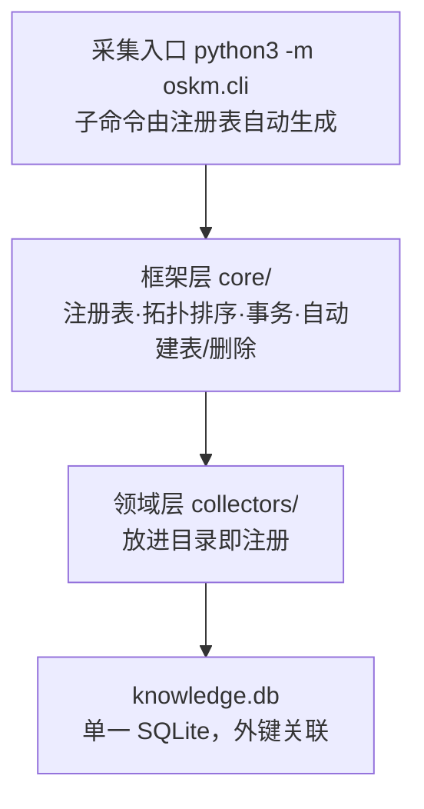
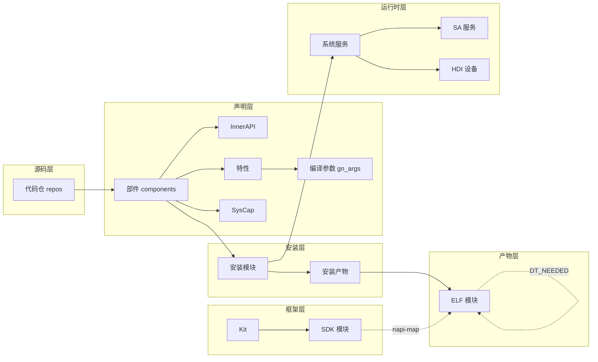

# oskm PPT 设计大纲（架构牵引版）

> 面向：技术领导 / 架构评审
> 目标：15 分钟讲清 oskm 与 OpenHarmony 零层架构的对应关系、核心工作过程与关键价值
> 叙事主线：**OpenHarmony 分层架构与部件模型 → 部件生命周期 → oskm 采集器逐环对应 → 数据模型 → 价值**
> 全文 12 页，每页含「要点」「视觉建议」「讲解口径」

---

## 第 1 页 · 封面

**标题**：oskm — OpenHarmony 系统知识扫描器

**副标题**：架构信息随构建自动生成，在亿级系统中一步直达实现层

**视觉**：oskm logo + slogan：「架构信息随构建自动生成，在亿级系统中一步直达实现层」

**讲解**：oskm 不是另起炉灶的工具——它的采集器划分严格对应 OpenHarmony 自身的分层架构和部件生命周期。今天先讲架构对应，再讲工作过程与价值。

---

## 第 2 页 · OpenHarmony 零层架构：分层设计

**要点**：OpenHarmony 整体遵从分层设计，从下向上四层

```
┌──────────────────────────────────────────┐
│  应用层        系统应用 + 第三方应用         │
├──────────────────────────────────────────┤
│  框架层        ArkUI / Ability / 多语言 API  │
├──────────────────────────────────────────┤
│  系统服务层    分布式软总线·图形·安全·       │
│               包管理·多媒体·DFX·……         │
├──────────────────────────────────────────┤
│  内核层        内核子系统 (Linux/LiteOS)     │
│               驱动子系统 (HDF)              │
└──────────────────────────────────────────┘
```

- **内核层**：多内核 + KAL 抽象层；HDF 驱动框架是硬件生态开放基础
- **系统服务层**：核心能力集合，分基本能力/基础软件/增强软件/硬件服务四类子系统集
- **框架层**：C/C++/JS 用户程序框架 + Ability 框架 + ArkUI + 对外多语言 API
- **应用层**：系统应用 + 第三方应用（FA/PA）

> 来源：OpenHarmony-Overview_zh.md "技术架构"

**视觉**：纵向四层金字塔，每层标注 2-3 个代表子系统

**讲解**：这是 OpenHarmony 官方技术架构。oskm 的扫描范围覆盖**内核层以上的系统服务层与框架层**——因为这两层是"部件化"的主体：它们的源码以 bundle.json 声明、以 GN 编译、以 SMI 安装、以 cfg/SA/HDI 运行。oskm 把这条链的每一段都结构化。

---

## 第 3 页 · 基本架构模型：系统 > 子系统 > 部件

**要点**：系统功能按"系统 > 子系统 > 部件"逐级展开，部件是可裁剪、可装配的基本单元

**部件定义**（来源：OpenHarmony 部件设计和开发指南）：
> 部件是系统能力的基本单元，以源码为划分依据，具有独立文件和目录，在不同设备上可实例化为对应的库或可执行文件。

**部件的构成**（bundle.json 声明）：

```
部件 (component)
├── name / subsystem        身份与归属
├── syscap[]                系统能力（绑定应用 API）
├── features[]              可配置特性（编译态开关）
├── build.inner_api[]       部件间接口（external_deps 唯一依赖途径）
├── build.modules[]         编译入口（产出安装模块）
└── deps.components[]       部件间依赖
```

**部件目录结构**（官方规范）：
```
interfaces/kits      应用接口 (js/native)
interfaces/inner_api  系统内部件间接口
frameworks/          无独立进程的实现
services/            独立进程的实现
test/                测试代码
BUILD.gn + bundle.json
```

**装配**：产品 config.json 按"子系统 + 部件 + 特性"维度选配，无需侵入源码

**视觉**：部件结构树 + 装配箭头（config.json → 选配 → 镜像）

**讲解**：部件不只是"代码目录"——它同时声明了能力（SysCap）、配置开关（features）、对外接口（inner_api）、编译产物和依赖。这些声明散落在 bundle.json、gn args、SMI、cfg、SA profile 里。**oskm 的工作就是把它们从分散文件收拢为关联事实**。

---

## 第 4 页 · 部件生命周期：从源码到运行时

**要点**：一个部件从源码到设备上运行，经过六个环节——每个环节有独立产物和声明文件

```
代码仓          部件声明          编译           安装            镜像产物        运行时
 .repo/     →  bundle.json  →  gn args    →  SMI          →  ELF .so     →  init cfg
 manifest       component       declare_args   install_       system/lib64/    services[]
 git HEAD       features[]      覆盖值         module_info    *.z.so          SA profile
                inner_api[]                    .json                          HDI hcb
                syscap[]
                deps[]
```

**六个环节的产物与声明文件**：

| 环节 | 声明文件 | 产物 | 典型问题 |
|------|---------|------|---------|
| 代码仓 | `.repo/manifests/default.xml` + git | 525 仓 + commit/remote | "这段代码在哪个仓？" |
| 部件声明 | `bundle.json` / `ohos.build` | 382 部件 + InnerAPI/特性/SysCap | "这个能力由哪个部件提供？" |
| 编译 | `gn args --list --json` | 2,952 编译参数 | "改这个开关影响谁？" |
| 安装 | `system_module_info.json` | 5,501 安装模块 + 镜像路径 | "这个 .so 是谁装的？" |
| 镜像产物 | 物理文件 (ELF) | 3,517 ELF + DT_NEEDED 依赖 | "这个二进制依赖了什么？" |
| 运行时 | `*.cfg` / SA profile / hcb | 164 服务 + 165 SA + 57 HDI | "foundation 进程跑哪些 SA？" |

**视觉**：横向六段流水线，每段上方标声明文件、下方标产物数量

**讲解**：这条链是 OpenHarmony 部件化设计的必然产物——每个环节都有官方规定的声明文件和结构化产物。问题是：这些文件各自独立，没人把它们关联起来。**oskm 的设计就是沿这条链逐环采集、用外键串联**。

---

## 第 5 页 · oskm 是什么：架构链的结构化投影

**定义**：
> oskm 沿 OpenHarmony 部件生命周期逐环采集，将每个环节的声明与产物存入单个 SQLite 库，用外键串联成一张可导航的知识图。

**三个"一"**：

| | 说明 | 对应架构 |
|---|---|---|
| **一条命令** | `oskm scan` 自动发现全部采集器、按依赖拓扑排序执行 | 部件装配的一条 config.json |
| **一张库** | 所有环节的数据在同一个 SQLite，跨环关系是 JOIN 不是副本 | 部件生命周期的六个环节关联 |
| **一套质量模型** | 每条事实带来源、每条问题分级分类 | 部件评审的属性可追溯 |

**视觉**：第 4 页的六段流水线在下方折叠成"一个数据库"图标，中间用漏斗

**讲解**：oskm 不是发明新概念——它把 OpenHarmony 自己定义的部件生命周期，原封不动地映射成十个采集器。架构有什么环节，oskm 就有什么采集器；环节间怎么传递，采集器间就怎么用外键关联。

---

## 第 6 页 · 基本组成与工作原理

**要点**：oskm 由三部分组成——采集流水线归档知识、knowledge.db 存储、Viewer 与 CLI/skill 两个出口消费

```
① 采集流水线            ② knowledge.db           ③ 两个出口
collector 采集归档  →   单一 SQLite 库      →   Viewer  供人工查看
· 10 个采集器拓扑序       · 外键关联              · 列表页 / 详情页 / 关联导航
· 每个只跑一次            · 多快照共存            CLI     供 Agent 应用
· 依赖经数据库传递        · 每条事实带来源+质量    · 52 个工具 / 沿架构链查询
· 一条命令 oskm scan                             · 每次构建即更新
```

**三个组成部分**：

| 组成 | 职责 | 服务对象 |
|------|------|---------|
| 采集流水线 | collector 沿部件生命周期逐环采集，归档声明+产物+关系 | 构建系统 |
| knowledge.db | 单一 SQLite，外键关联，多快照共存 | 全部消费者 |
| Viewer | 人工查看各类架构知识（列表/详情/面包屑导航） | 开发者/评审人 |
| CLI / skill | 52 个查询工具 + 6 条架构命令，Agent 沿架构链应用最新知识 | AI Agent |

**视觉**：左中右三列——左列采集流水线（蓝）、中列 knowledge.db（深色库图标）、右列上下两卡 Viewer（绿）+ CLI/skill（橙），箭头串联

**讲解**：一条流水线归档 → 一个库存储 → 两个出口消费。同一份事实，不同粒度：人工看 Viewer 浏览关联，Agent 用 CLI/skill 精确查询。两个出口读同一张库，不各存一份。

---

## 第 7 页 · 核心对应：10 个采集器 = 架构链 1:1 映射

**要点**：oskm 的每个采集器恰好对应部件生命周期的一个环节，拓扑排序 = 生命周期的执行顺序

```
OpenHarmony 架构层          oskm 采集器（拓扑序）              产出表
─────────────────────       ─────────────────────             ──────────────
代码仓（全层基础）      →    repos                          →  repos
框架层（SDK 接口）       →    arkts                          →  arkts_modules/kits/sources
系统服务层·部件声明     →    components                     →  components/innerapis/features/syscaps
系统服务层·编译         →    args                           →  gn_args
系统服务层·安装         →    install_modules                →  install_modules/install_targets
  └ 跨环关联            →    component_links                →  feature_switches/innerapi_modules
系统服务层·运行时进程   →    services → hdi → sas           →  services/hdis/sas
  └ 物理产物            →    elf_modules                    →  elf_modules/elf_module_dependencies
  └ SDK→实现闭环        →    arkts_links                    →  module↔ELF 关联
```

**对应关系三条规律**：
1. **采集器拓扑序 = 部件生命周期顺序**：源码 → 声明 → 编译 → 安装 → 运行 → 产物
2. **每个采集器只读它对应环节的声明文件**：repos 读 manifest、components 读 bundle.json、services 读 cfg、arkts 读 .d.ts——不跨环节读
3. **跨环关联由独立采集器承担**：component_links（features→gn_args、innerapis→install_modules）、arkts_links（SDK 模块→实现 ELF）——不破坏"每个采集器只写自己的表"

**视觉**：双列对照——左列 OpenHarmony 架构层，右列 oskm 采集器，中间箭头一一对应；底部标注"拓扑序 = 生命周期"

**讲解**：这一页是架构依据的核心。不是 oskm 自己定的十个域——是 OpenHarmony 的分层架构和部件模型天然有这些环节，oskm 只是把它们对应采集。依赖拓扑排序保证：下游采集器通过数据库读上游结果，与部件"声明→编译→安装→运行"的天然顺序完全一致。

---

## 第 8 页 · 核心工作过程：框架机制

**要点**：注册表 + ABC 强制接口 + 声明式表定义——"放进目录即注册，零框架修改"

**三层架构**：



**四个机制（对照 OpenHarmony 部件化理念）**：

| 机制 | oskm 做法 | 对应 OpenHarmony 理念 |
|------|-----------|---------------------|
| 自动发现 | `@register` + pkgutil 包扫描 | 部件"放进目录即编译"——同理，采集器"放进目录即注册" |
| ABC 强制 | BaseCollector 是抽象基类，必须实现 collect/声明 TABLES | 部件必须有 bundle.json + BUILD.gn——同理，采集器必须声明表 |
| 声明式表 | 采集器声明 TABLES，框架自动建表+按 scan_id 删除 | 部件声明 build.modules，构建框架自动产出——同理，框架从声明生成 DDL |
| 事务原子 | 每个采集器一个事务写入，CASCADE 删除 | 部件编译原子性——同理，采集器要么全写入要么全回滚 |

**视觉**：三层架构图 + 四个机制与 OH 理念的对照表

**讲解**：oskm 的框架设计有意识地复刻 OpenHarmony 的部件化理念——声明驱动、自动发现、框架兜底。新增一个采集器的成本，和 OpenHarmony 新增一个部件一样低。

---

## 第 9 页 · 统一数据模型：record 全集 + 投射列 + 外键关联

**要点**：每个实体存原始声明全集（保精度保中文），投射列只是索引，跨环关系全部是外键 JOIN

**归属链示例**（一条服务声明回溯到源码仓，贯穿四个架构层）：

```
运行时层  service.cfg "system/etc/init/foundation.cfg"
            ↓ install_targets.dest 精确匹配
安装层    install_modules "//foundation/systemabilitymgr/samgr:samgr"
            ↓ components.manifest 路径前缀匹配
声明层    components "samgr_standard"  (subsystem: systemabilitymgr)
            ↓ repos.path 最长前缀匹配
源码层    repos "systemabilitymgr_samgr"
            ↓ repos.remote_url
          https://gitcode.com/openharmony/systemabilitymgr_samgr
```

**实体关系全景**：



**视觉**：归属链纵向流程（贯穿四层）+ 实体关系横向全景（层与层之间的外键）

**讲解**：这张图的两条线都对应架构——纵向归属链恰好从应用运行时一路回溯到源码仓，横向全景恰好是各架构层之间的依赖关系。每一步都是最长前缀或精确匹配，不读源码树、不猜位置。查"一个 .so 属于谁"就是沿这条链走 JOIN。

---

## 第 10 页 · 关键价值（一）：给 Agent 用——52 个查询工具

**要点**：oskm 库已封装为 CLI 与 skill，Agent 不需要 grep 源码就能沿架构链精确回答结构问题

**典型场景**（标注对应架构层）：

| Agent 问题 | 调用工具 | 答案沿架构链的方向 |
|-----------|---------|------------------|
| "libabilitystage.z.so 是谁？" | `owner_of(dest)` | 产物层 → 声明层 |
| "AbilityKit 包含哪些模块？实现 so？" | `arkts_kit_modules` + napi-map | 框架层 → 产物层 |
| "改这个 gn arg 影响谁？" | `get_gn_arg` → features 反查 | 声明层（编译）→ 声明层（部件） |
| "foundation 跑哪些 SA？" | `service_hosted` | 运行时层内部 |
| "两版本差了什么？" | `diff_scans` | 全链跨库对比 |
| "任意 API → 实现 so" | `list_arkts_modules(implemented_by=so)` | 框架层 → 产物层 |

**数字**：13 个模块、52 个工具，覆盖全部 10 个采集器域

**视觉**：左侧 Agent 提问，右侧工具+答案方向，中间架构链箭头标明"沿哪段走"

**讲解**：每个工具调用本质上是沿架构链走一段 JOIN。Agent 不再需要"打开 5 个文件拼答案"——一条工具直达事实，且每条事实带来源路径和质量状态。**oskm 把"知道系统结构"从搜索问题变成查询问题**。

---

## 第 11 页 · 关键价值（二）+ 架构亮点与实测

**三个价值场景**：

**① 架构评审——"改一处影响多大"**
- 任意部件 → 正向/反向依赖闭包（声明层内）
- 任意 .so → ELF 依赖闭包 BFS（产物层，影响面）
- 任意 gn arg → 哪些部件声明此特性（编译→声明）

**② 质量门禁——"扫出来的一定有出处"**
- 两条质量轴：`advisory=0`（没读全→degraded）/ `advisory=1`（读到了但可疑→门槛）
- 每条问题带 path + pointer + code + severity，定位到文件和 JSON 位置
- rk3568：13 条扫描层问题 + 88 条 advisory，全部可追溯

**③ 版本对比——"两版本差了什么"**
- 多快照共存，`diff_scans` 结构化差异（added/removed/changed）
- `ATTACH` 跨库对比

**架构亮点**：

| 特性 | 说明 |
|------|------|
| 零第三方依赖 | 纯标准库 + SQLite，任何环境直接运行 |
| 依赖经数据库传递 | 单领域重扫从 9 次降为 1 次 |
| record 全集 + 投射列 | 保精度保中文，列可增删不丢信息 |
| 外键强引用完整 | CASCADE 删除，归属不悬空 |

**rk3568 实测**：12 采集器 · 525 仓 + 382 部件 + 5,501 模块 + 3,517 ELF + 164 服务 + 165 SA + 1,319 SDK 模块 + 441 Native SDK 头文件映射 · 全量扫描约 2 分钟 · 库 17.5 MB · 272 单元测试通过 · 52 个查询工具

**视觉**：左半三个价值场景，右半亮点表 + 实测数字（大字号）

**讲解**：三个场景的共同点——以前需要人沿架构链逐环查，现在 oskm 用外键 JOIN 一步到位。20 秒扫完整工程，产出 3MB 可查询事实库，这不是 PoC，是已验收的产品级工具。

---

## 第 12 页 · 演进方向与总结

**已规划演进**（对照架构层）：

| 方向 | 内容 | 对应架构层 |
|------|------|-----------|
| API 级采集 | SDK class/interface/方法/签名/权限/版本 | 框架层（更细粒度） |
| SDK→实现 so 闭环 | 任意 api/module/class/kit → 实现 ELF | 框架层 → 产物层 |
| 全库关联图 | arkts 经 @syscap 接入部件/SysCap 关联 | 框架层 ↔ 声明层 |
| 多版本基线 | CI 集成 diff_scans 自动产出版本差异 | 全链 |

**一句话总结**：

> 让架构信息随构建自动沉淀，成为准确、实时、可直达实现的知识基座。
>
> OpenHarmony 用"系统 > 子系统 > 部件"定义架构，oskm 沿部件生命周期逐环采集、用外键串联——架构有什么环，oskm 就采什么环；环间怎么连，外键就怎么串。每次构建即更新，架构与实现始终同源、同步、同构。

**视觉**：演进路线时间轴 + 总结 slogan（随构建沉淀 → 知识基座）

**讲解**：核心价值不在"扫得快"，在于 oskm 的设计与 OpenHarmony 自身架构同构——架构的每一层、部件生命周期的每一环，都有对应的采集器和外键关联。这让 oskm 扫出来的不是一次性的报告，而是一份与架构同构的、可累积、可查询的资产。

---

## 附：制作建议

| 项 | 建议 |
|----|------|
| 页数 | 12 页，控制在 15 分钟 |
| 风格 | 深色背景 + 高对比数字，技术感 |
| 图表 | 第 2 页 OH 分层金字塔；第 4 页生命周期流水线；第 6 页三组成工作原理；第 7 页架构层↔采集器双列对照（核心页）；第 9 页 mermaid 关系图 |
| 动画 | 第 4 页流水线按序点亮六段；第 6 页三列按序点亮采集→库→出口；第 7 页双列对照逐行亮起对应箭头；其余静态 |
| 讲解重心 | 第 2-4 页（架构牵引）3 分钟 + 第 7 页（对应关系）3 分钟 + 第 10-11 页（价值）5 分钟 |
| 备选开场 | 如听众偏产品，从第 9 页 Agent 场景开场再回溯架构 |
| 架构出处 | 第 2 页引 OpenHarmony-Overview_zh.md"技术架构"；第 3 页引"部件设计和开发指南" |
