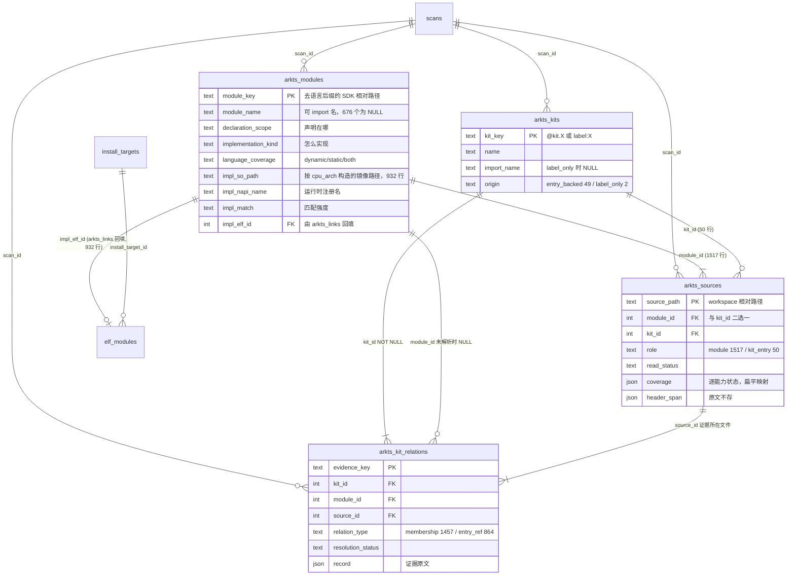

# ArkTS 数据模型审视

日期：2026-10-25
对象：schema **7.0.0** 的四张表。模型设计见 [design.md](./design.md)。
全部数字基于 rk3568 全量扫描库与采集器源码，测量方法见 §8。

上一版（2026-10-24）提出的三项改造——`arkts_sources`、NAPI 实现映射、
`source_category` 按实现方式重分类——**已全部实施**。此后又做了两轮精简，
本文记录 7.0.0 的现状与残留问题。

## 摘要

| 议题 | 状态 |
|---|---|
| 源文件表 | `arkts_declarations` → **`arkts_sources`**，19 列精简到 15 列 |
| 实现映射 | **已接入**。932 个模块带实现路径，**932/932 解析到镜像内唯一 ELF 行** |
| 分类重设计 | `source_category` → **`declaration_scope` + `implementation_kind`**，职责各一 |
| 实现表折叠 | `arkts_module_impls` 严格一对一，**折叠成 `arkts_modules` 上的四列**，少一张表 |
| 冗余字段 | 已清 ~464 KB；剩 ~200 KB 可去，集中在 2 个字段；另有 4 个字段**看似单值但不是冗余** |
| 定义文件可达性 | 模块 1,319/1,319、Kit 51/51，但 label_only 走的是第三条路径，上层未表达 |

---

## 1. 表关系



| 表 | 列 | 行 | 表页字节 |
|---|---:|---:|---:|
| `arkts_modules` | 11 | 1,319 | 217,088 |
| `arkts_kits` | 6 | 51 | 4,096 |
| `arkts_sources` | 15 | 1,567 | 442,368 |
| `arkts_kit_relations` | 23 | 2,321 | 884,736 |
| `arkts_links_run`（另一采集器） | 5 | 1 | 4,096 |
| **合计** | | | **1,552,384** |

两张实体表**无出边**（`impl_elf_id` 除外，由另一采集器回填）；
源文件表指向实体；证据表再指向源文件。插入顺序即由此确定。

**对外连接**：`arkts_modules.impl_elf_id → elf_modules`（932 行，全部命中）——
arkts 第一次真正接入全库关联图。原先的 `repo_id → repos` 边已删除（见 §5.1）。

### 1.1 为什么 `arkts_module_impls` 折叠掉了

那张表实测 **932 行对 932 个模块，严格一对一**：

```
SELECT count(*), count(DISTINCT module_id) FROM arkts_module_impls  →  932, 932
```

一对一的子表不表达任何父表表达不了的东西，代价是多一张表、多一次 join、
viewer 里多一层。它的五列原样搬到 `arkts_modules` 上（`source_id` 随
`napi-map.json` 不入库一并删除，`impl_source` 与 `match_method` 合并成
`impl_match`，因为 `arkui_engine` 既是来源也是匹配方式）。

一对一**不是结构保证**——将来若一个模块可能由多个 .so 实现，得拆回去。
当前映射表每个模块至多一条，拆表属于为假想需求付费。

---

## 2. 字段含义

### 2.1 arkts_modules

| 字段 | 含义 |
|---|---|
| `module_key` | 业务键。SDK 相对路径**去掉语言后缀**：`api/@ohos.arkui.UIContext` |
| `module_name` | 可按裸标识符 import 的名字。643 个非空，676 个 NULL |
| `declaration_scope` | api_named(640) / api_auxiliary(426) / internal_component(140) / arkts_builtin(106) / arkts_named(4) / internal_ets(3) |
| `implementation_kind` | napi(525) / arkui(407) / type_only(172) / unknown(108) / arkts_builtin(106) / arkts_language(1) |
| `language_coverage` | dynamic(908) / static(213) / both(198) |
| `impl_so_path` | 按 `cpu_arch` 构造的镜像路径：arm 为 `system/lib/…`，arm64 为 `system/lib64/…`。932 行非空 |
| `impl_napi_name` | NAPI 运行时注册名；arkui 行为 NULL |
| `impl_match` | module_name(501) / arkui_engine(407) / declaration_path(17) / name_suffix(7) / NULL(387) |
| `impl_elf_id` | 镜像中的 ELF 行，由 `arkts_links` 回填。932/932 |

`impl_*` 四列要么全空（387 个模块，无实现证据），要么成组出现。

### 2.2 arkts_kits

| 字段 | 含义 |
|---|---|
| `kit_key` | 业务键。`@kit.AbilityKit` 或 `label:<原标签>` |
| `name` | 展示名，去前缀，保留内部空格与大小写 |
| `import_name` | entry_backed 时等于 kit_key；label_only 为 NULL |
| `origin` | entry_backed(49) / label_only(2) |

### 2.3 arkts_sources

逐字段的含义、可推导性与精简判定见
[arkts-sources-field-report.md](./arkts-sources-field-report.md)，此处只列概要。

| 字段 | 含义 |
|---|---|
| `source_path` | 业务键。声明文件的 workspace 相对路径 |
| `module_id` / `kit_id` / `role` | 这份文件声明哪个实体。role: module(1,517) / kit_entry(50) |
| `declaration_format` | d.ts(1,074) / d.ets(81) / static.d.ets(412)，语法事实 |
| `language_variant` | dynamic(1,155) / static(412)，后缀对应的语言版本，**永远单值** |
| `file_condition` / `condition_evidence` | 文件**内容**声明的适用模式及原文证据，与后缀无关 |
| `byte_size` | 实际读取字节数 |
| `read_status` | ok(1,566) / encoding_failed(1) / … |
| `header_status` | ok(1,507) / no_tag(59) / failed(1) / partial |
| `coverage` | 逐能力提取状态，扁平 JSON `{能力: 状态}` |
| `header_span` | 文件头字节跨度，**原文不存** |

6.0.0 相对 3.0.0 删掉了 `kind`、`sha256`、`repo_id`、`references_status` 四列，
并把 `coverage` 扁平化：**19 列 → 15 列，864 KB → 442 KB（−49%）**。

### 2.4 arkts_kit_relations

逐字段的含义、可推导性与精简判定见
[arkts-kit-relations-field-report.md](./arkts-kit-relations-field-report.md)，此处只列概要。

| 字段 | 含义 |
|---|---|
| `evidence_key` | 业务键 = `canonical([SDK相对路径, relation_type, start, end])` |
| `kit_id` / `module_id` / `source_id` | 关系两端 + 证据所在文件 |
| `relation_type` | declared_membership(1,457) / entry_reference(864) |
| `evidence_state` | confirmed / candidate |
| `statement_kind` | kit_tag(1,457) / import_from(848) / export_from(16) / … |
| `source_path`、`start_byte`、`end_byte`、`line`、`column` | 证据定位 |
| `target_text` / `target_kind` | 原标签值或 specifier |
| `resolution_status` / `_method` / `_reason` | 五态（本产品全 resolved）；method = header_exact(1,457) / named_exact(864)；reason 全 NULL |
| `candidate_keys` | 候选模块键数组 |
| `condition_state` / `condition_evidence` | 全表 unspecified(1,504) / static(650) / both(89) / dynamic(78)。membership 行是文件级条件的**副本**，entry_reference 行来自语句所在的条件块 |
| `record` | 该跨度的原文 |

**两套相对路径是刻意的**：`module_key` 用 SDK 相对（import specifier 在这个坐标系里解析），
`source_path` 用 workspace 相对（要定位仓内文件、拼源码 URL）。重构中曾统一成前者，
导致仓匹配静默失效。

---

## 3. 两个分类列

一个字段承担不了两件事。**声明在哪**永远可判定，**怎么实现**需要证据且可能未知。

把两者交叉，可以看到旧的单列分类为什么不成立：

| declaration_scope | napi | arkui | type_only | arkts_builtin | arkts_language | unknown |
|---|---:|---:|---:|---:|---:|---:|
| **api_named** | **505** | **26** | 1 | 0 | 0 | **108** |
| **api_auxiliary** | **17** | **238** | **171** | 0 | 0 | 0 |
| internal_component | 0 | 140 | 0 | 0 | 0 | 0 |
| internal_ets | 0 | 3 | 0 | 0 | 0 | 0 |
| arkts_builtin | 0 | 0 | 0 | 106 | 0 | 0 |
| arkts_named | 3 | 0 | 0 | 0 | 1 | 0 |

`api_named` 和 `api_auxiliary` 各自横跨 3–4 种实现方式，合计占全部模块的 **81%**。
只有三个 scope 是纯的。

`implementation_kind` 依赖 `napi-map.json`，而后者是版本绑定的参考数据——换一版映射表，
同一个模块可能从 `unknown` 变成 `napi`。该文件**不入库**（它是采集过程的输入，不是
sdk-js 仓里的声明文件），其摘要记在 `collector_runs.scope.napi_map`，
并计入 `input_digest`，换一版映射表游标即失效。

---

## 4. 实现映射结果

| | |
|---|---:|
| `napi-map.json` 条目 | 586 |
| `module_name` 精确（含 `@`+名 的 3 条） | 501 |
| `declaration_path` 路径精确 | 17 |
| `name_suffix` 唯一后缀兜底 | 7 |
| **合计命中** | **525** |
| **对不上任何模块**（advisory） | **61** |
| ArkUI 模块（引擎实现） | 407 |
| **`impl_so_path` 非空合计** | **932** |
| **解析到镜像内唯一 ELF 行** | **932 / 932** |
| 历史模型中靠架构别名命中 | **932** |
| 路径不在镜像 / 多命中 | 0 / 0 |

61 条未命中的逐条分类、四条规则的强度排序与反证见
[design.md §3.8.1–3.8.3](./design.md)。摘要：**60 条在 SDK 里无任何声明**
（ArkUI 内部控制器 6、Ability 运行时对象 12、内部/平台模块 42），
**1 条名字有歧义**（`serial` 同时匹配 busManager 与 usbManager，其 .so 目录段
`usbmanager` 恰好反证了后缀规则会选错）。

### 4.1 架构段归一是必需的，不是优化

映射表写的是 64 位路径（`system/lib64/module/...`），而 rk3568 是 32 位
（3,513/3,517 的 ELF 为 ARM32，镜像里 `system/lib64/` 下**零个**安装目标）。
因此采集器必须在落库前按 `scans.cpu_arch` 把库根改写成 `system/lib/`；否则存下来的
不是本次产品的路径事实，后续只能靠查询侧或关联侧做别名补偿。

当前模型选择在投影时一次归一，`impl_so_path` 与 `install_targets.dest` 使用同一套
架构根并精确关联。历史上的 64 位字面路径命中率与别名统计不再代表当前库语义。

### 4.2 全路径解决了同名歧义

按文件名匹配时，有 **14 个 `.so` 名在镜像中出现 2–3 次**
（`libcommon.z.so`、`libutils.z.so`、`libsms.z.so` 等，同分区不同部件）。
改用按 `cpu_arch` 归一后的全路径后，14/14 都能唯一定位。

这正是全路径相对裸文件名的价值所在。

### 4.3 端到端抽查

| 模块 | kind | 参考数据路径（64 位） | 当前库 `impl_so_path` / 镜像实际 | 部件 |
|---|---|---|---|---|
| `@ohos.app.ability.UIAbility` | napi | `system/lib64/module/app/ability/libuiability.z.so` | `system/lib/…/libuiability.z.so` | ability_runtime |
| `@ohos.multimedia.image` | napi | `system/lib64/module/multimedia/libimage.z.so` | `system/lib/…/libimage.z.so` | image_framework |
| `api/@internal/ets/button` | arkui | `system/lib64/platformsdk/libace_engine_pa_ark.z.so` | `system/lib/platformsdk/…` | ace_engine |

反向也成立：`libace_engine_pa_ark.z.so` ← 407 个 ArkUI 模块。

---

## 5. 冗余判定

判定方法：对每个字段写 `SELECT count(*) WHERE 实际值 != 推导式`，反例为 0 才记为可推导；
再回读源码区分"构造上的纯函数"与"本数据恰好重合"。**这两者混为一谈会删错东西。**

### 5.1 已清理

| 字段 | 清掉的占用 | 依据 |
|---|---:|---|
| `sources.coverage` 的 `extractor_version` | 244,452 字符 | 每行重复 4 次，全库一个值，已在 `scope.backend.capabilities`。改扁平映射后 444,524 → 200,072 |
| `sources.references_status` | 20,121 字符 | 完全是 `coverage['kit.references']` 的投射，0 反例 |
| `sources.sha256` | ~104 KB | 输入身份已由 `scope.files_digest` 一个总摘要锁住。**代价**：失去逐文件内容校验，见字段报告 §4 |
| `sources.repo_id` + `kind` 行 | — | arkts 只扫一个根，恒单值；源码 URL 按路径前缀匹配，不读它 |
| `arkts_module_impls` 整表 | 118,784 字节 | 严格一对一，折叠为四列，见 §1.1 |

### 5.2 仍可清理

| 字段 | 占用 | 依据 | 风险 |
|---|---:|---|---|
| `kit_relations.source_path` | 117,913 字符 | 精确重复 `source_id` 指向行的业务键，2,321/2,321 相等。`records.py` 已为它开特例避免导出两份——**代码自己承认了这是副本** | `query.py` 几处要改 join |
| `kit_relations.candidate_keys` | 82,104 字符 | resolved 行恒为 `[该模块]`，2,321/2,321 命中 | 导出字段语义微调 |

`sources.coverage` 剩下的 200,072 字符**不再拆**：拆成四个固定列能到 ~56 KB，
但会把表结构钉死在当前四个能力上，与解析核心"加一个事实 = 加一个提取器 + 一条注册，
不动四表"的扩展契约冲突。扁平 JSON 多一个键即可，省了 55% 又不违约。

### 5.3 构造上可推导但刻意物化

| 字段 | 推导式 | 保留理由 |
|---|---|---|
| `sources.language_variant` | `models.VARIANTS[后缀]` | 语法列与语义列各自可直接过滤 |
| `modules.declaration_scope` | `classify()` 对路径的纯函数 | 固化扫描当时的分类规则 |
| `modules.language_coverage` | 子表聚合 | viewer 平表过滤免 join |
| `kits.name` / `import_name` | `kit_key` 的纯函数 | 51 行；`import_name` 是 CHECK 约束的锚点 |
| `kit_relations.evidence_key` | `canonical([路径,类型,跨度])` | 业务键，游标与导出身份依赖它 |
| `sources.role` | 近似等于两个 FK 是否为空 | 文件名非法的 Kit 入口两者皆空（本产品 0 条，代码路径在） |

关于 `language_coverage`：曾用 `install_targets.size` 类比辩护，**该类比不成立**——
`size` 是 lstat 观测值不可推导，`language_coverage` 是纯聚合，理由只剩"前端免 join"。

### 5.4 不是冗余——本输入未覆盖的分支

| 字段 | 现状 | 为何不能删 |
|---|---|---|
| `sources.file_condition` | 与 `language_variant` 0 反例 | 规则不同源：前者看**内容**（`'use static'` 指令），后者看**后缀**。一份 `.d.ts` 写上指令即分叉 |
| `kit_relations.target_kind` | 只有 1 个取值 `module` | 864 条引用全部 resolved，本 SDK 的 Kit 入口没有外部包或 `@kit.X` 引用 |
| `kit_relations.resolution_reason` | 全为 NULL | 没有 not_found / ambiguous 发生 |
| `kit_relations.resolution_method` | 2 个取值 | `relative_exact` 分支未被触发 |
| `modules.impl_elf_id` | 本产品 932/932 非空 | 路径不在镜像时必须能留空，那与"不知道实现"是两个事实 |

把"本次数据只有一个值"当成"字段冗余"，是数据模型审视里最常见的错误。

---

## 6. 可达性

### 6.1 实体 → 定义文件：100%

| 实体 | 数量 | 路径 | 覆盖 |
|---|---:|---|---|
| 模块 | 1,319 | `arkts_sources.module_id` | **1,319 / 1,319** |
| entry_backed Kit | 49 | `arkts_sources.kit_id` | **49 / 49** |
| label_only Kit | 2 | 无定义文件，经 `kit_relations.source_id` 到**提及它的**模块文件 | 2 / 2 |

孤儿模块 0；声明文件数分布为 1 份 1,121 个、2 份 198 个。

`label_only` 没有定义文件，是因为**它根本没被定义**——只是某个模块头上写了个对不上入口的
标签。能给出的最好答案是"在哪里被提到过"。

### 6.2 实体 → 实现 .so

```
module → arkts_modules.impl_elf_id → elf_modules → install_targets.dest
kit    → arkts_kit_relations.module_id → 同上（Kit 本身无实现，经其模块）
```

折叠后这条路径少一跳。932 个模块（napi 525 + arkui 407）可达唯一 ELF；其余 387 个
（type_only 172 + unknown 108 + arkts_builtin 106 + arkts_language 1）`impl_*` 全空。
**空表示"不知道由谁实现"或"本就不需要实现"，不是"解析失败"**——
用 `implementation_kind` 区分这两者。

### 6.3 残留缺口：label_only 的第三条路径上层不可见

| 层 | entry_backed | label_only |
|---|---|---|
| FK 图（驱动 viewer 关联区） | `sources → kits` 有边 | **无边** |
| `get_kit()` 的 `sources` | total=1 | **total=0，空列表** |
| `get_kit()` 的 `evidence` | 432 条 | 1 条，`source_path` 指向模块文件 |

数据到得了，**语义没表达出来**。建议 `get_kit()` 在 `sources` 为空时补 `mentioned_in`，
只动 `query.py`，无 schema 变更。

---

## 7. 待办与未决

| # | 动作 | 收益 | 风险 |
|---|---|---|---|
| 1 | `get_kit()` 补 `mentioned_in` | 填上 §6.3 的表达缺口 | 只动 `query.py` |
| 2 | 删 `kit_relations.source_path`，改走 `source_id` join | ~118 KB | `query.py` 几处要改 join |
| 3 | `candidate_keys` 在 resolved 时存 `[]` | ~82 KB | 导出字段语义微调 |
| 4 | membership 行不复制 `condition_*`（文件级条件的副本） | ~42 KB | 读者要 COALESCE 到 `arkts_sources` |
| 5 | 删 `kit_relations.evidence_key`，改 `(source_id, start_byte)` 复合键 | ~156 KB + **~434 KB 索引** | 要改框架两处 `primary_key[0]`，**影响全部采集器，应单独立项** |

第 2—4 项合计 242,153 字符（这张表的 31%），全部是"同一个值存了两遍"，没有语义损失；
逐条依据见 [arkts-kit-relations-field-report.md](./arkts-kit-relations-field-report.md)。

已完成（原清单第 4 项）：`coverage` 改表示法，省 244 KB。

**未决事项**

1. **`serial` 保持未匹配**。消歧需要引入 .so 目录段作为信号
   （`module/usbmanager/` → `@ohos.usbManager.serial`）；规则可行，但会让匹配依赖
   路径约定，尚未实施。
2. **108 个 `unknown` 模块**没有任何实现证据，保持 unknown，不强行归类。
3. `arkts_napi_classes`（class → so）按要求暂不实现。输入的 821 条是**去重后**的结果：
   SDK 实证 `Options` 在 13 个文件里声明、`Config`/`Context`/`Callback` 各 3 个，
   而映射表每名只有 1 条，生成时丢弃了碰撞项。将来若要做，这一点必须先解决。
4. **`impl_*` 一对一不是结构保证**。若将来一个模块可由多个 .so 实现，需拆回子表；
   见 §1.1。

## 8. 测量方法

- **依赖图 / 字段清单**：`PRAGMA foreign_key_list`、`PRAGMA table_info` 逐表读取
- **冗余判定**：每个假设一条 `SELECT count(*) WHERE 实际值 != 推导式`，反例为 0 才记可推导；
  再回读 `models.py`/`discovery.py`/`projection.py` 区分构造必然与数据巧合。
  JSON 列必须用 canonical 形式比较——库里无空格，比较串多一个空格会造出 412 个假反例
- **体量**：`sum(length(列))` 统计字符；`dbstat` 虚表统计**表页**字节（不含索引页，
  与本文历次数字口径一致）
- **一对一验证**：`count(*)` 与 `count(DISTINCT module_id)` 对照，相等才折叠
- **实现映射**：四条规则按强度依次匹配；未命中项再按"末段同名"在全 SDK（含 zh-cn）
  做文件系统直查以分类；so 路径按扫描 `cpu_arch` 归一后与 `install_targets.dest`
  精确求交，并统计多命中
- **类名碰撞**：`grep -rlE '^\s*(export\s+)?(declare\s+)?(interface|class|enum)\s+<名>\b'`
  统计 SDK 内声明同名类型的文件数，与映射表条目数对照
- **可达性**：UNION ALL 查询比对 `count(DISTINCT key)` 与实体总数；另查孤儿行
- **采集顺序**：`python3 -m oskm.cli list` 的 `order` 字段
- **端到端**：真实调用 `ArktsQuery.get_module()`，并由 `verify_arkts.py` 从
  `napi-map.json` 独立重算分类与链接，不信任采集器自己的 join
