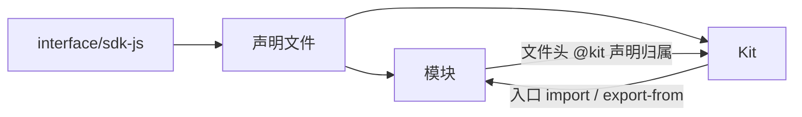
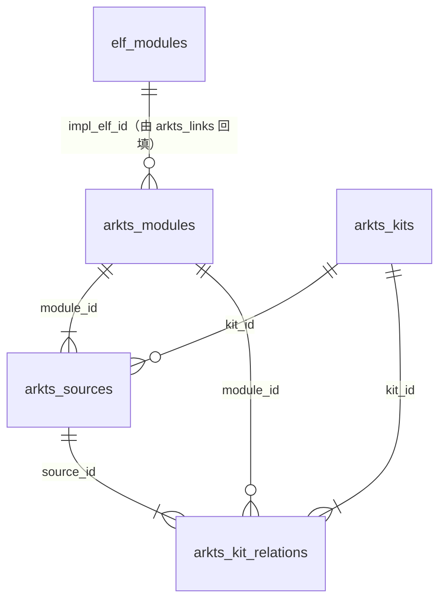
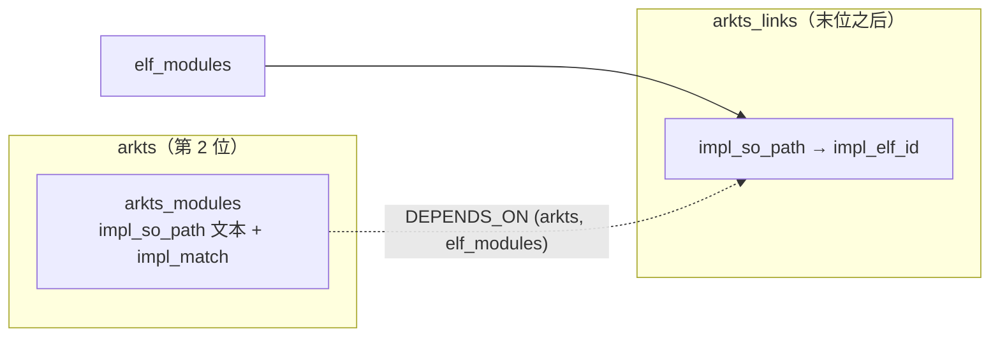
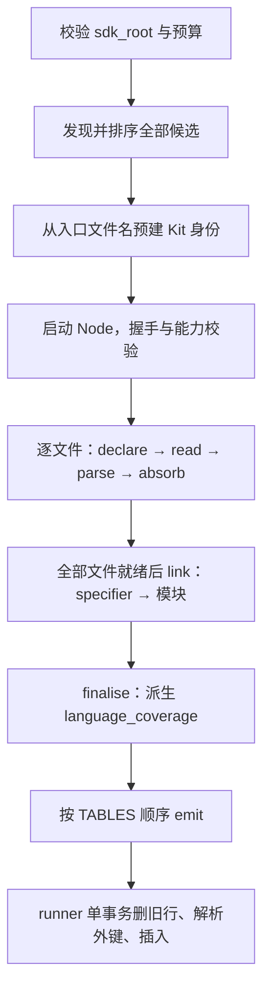

# ArkTS 采集模型与详细设计

状态：**第一阶段已实现**，schema 7.0.0。实测数据与验证方法见 [validation.md](./validation.md)，
解析核心见 [parser-core.md](./parser-core.md)，可运行命令见 [README](./README.md)。

本文描述**采集什么、如何建模、如何落库和查询**。源码如何被解析成事实，在 parser-core.md。

---

## 1. 目标与边界

oskm 已有部件、安装模块、ELF 和系统服务的知识。本域补充面向应用开发的 SDK 组织方式，
第一阶段回答：**有哪些 SDK 模块、有哪些 Kit、二者如何关联。**



采集止于模块边界。模块内部的 namespace、class、interface、函数、方法、属性、枚举值、
重载、参数和返回值均不形成知识实体。

### 1.1 使用场景

| 编号 | 用户问题 | 返回 |
|---|---|---|
| UC-01 | SDK 有哪些 Kit？ | 入口存在的 Kit、入口名与声明文件；仅标签出现的分组另列 |
| UC-02 | AbilityKit 关联哪些模块？ | 去重模块清单、关系类型、来源文件、条件与解析状态 |
| UC-03 | `@ohos.app.ability.UIAbility` 属于哪个 Kit？ | 文件头声明的 Kit，以及引用它的 Kit 入口；允许多项 |
| UC-04 | ArkUI 的声明文件在哪里？ | Kit 入口文件、带 ArkUI 标签的模块及其各语言版本声明 |
| UC-05 | 哪些模块没有 Kit 归属？ | 区分无标签、标签未匹配入口、读取失败；是否被入口引用独立显示 |
| UC-06 | 某条关系可靠吗？ | 原始标签或语句、行号、解析依据、候选目标与问题说明 |
| UC-07 | 采集是否完整？ | 文件清点、模块与 Kit 数量、关系证据数、未解析项和失败原因 |

### 1.2 第一阶段不纳入

| 不纳入项 | 本阶段处理 |
|---|---|
| 模块内部 API 结构、签名、成员 JSDoc | 不解析、不建表，不提供 API 搜索或数量统计 |
| 权限、错误码、API 起始/废弃版本、SysCap | 不解析，不提升为模块属性 |
| public/system/internal 可见性 | 不判定；目录名不作为整个模块可见性的结论 |
| 实现部件、NAPI/ANI、ELF、SA/HDI 映射 | 不采集、不匹配，不依赖产品构建或 components 扫描 |
| 普通模块之间的依赖图 | 只读取 Kit 入口中的模块引用，不采集模块间 import |
| Kit 间接暴露的模块或 API | 不递归展开中间模块，不计算传递闭包，不验证内部导出符号 |
| 最终 SDK 发布清单与设备支持性 | 不判断；结果描述工作区源码，不证明已打包或设备可用 |

证据原文中可能含导入名称，这不等于将 API 名称结构化采集。

## 2. 输入基线

默认输入为 `workspace/interface/sdk-js/{api,arkts,kits}`。按 `.d.ts` / `.d.ets` 递归清点，
后缀分组互斥：

| 目录 | `.d.ts` | `.d.ets` | `.static.d.ets` | 文件数 |
|---|---:|---:|---:|---:|
| `api/` | 980 | 77 | 349 | 1,406 |
| `arkts/` | 45 | 4 | 62 | 111 |
| 模块侧小计 | 1,025 | 81 | 411 | **1,517** |
| `kits/` | 49 | 0 | 1 | **50** |
| 合计 | 1,074 | 81 | 412 | **1,567** |

原始大小 43,678,765 字节。`zh-cn/` 另有 1,277 份声明文件，本域排除，避免重复计数。
`build-tools`、测试夹具、普通 `.ts`/`.ets` 实现和非声明资源同样排除。

这些是某一次源码版本的清点结果，不硬编码进代码。

---

<a id="model"></a>

## 3. 采集模型

### 3.1 实体是模块，不是声明文件

一个模块可以有两份声明：`X.d.ts`（或 `X.d.ets`）声明 ArkTS 1.1 版本，`X.static.d.ets`
声明 1.2 版本。它们是**同一个模块的两种语言形态**，不是两个模块。

1.0.0 曾以声明文件为模块主键，后果是 import 无法唯一定位——1,567 份文件里有 198 对
这样的双声明，142 条入口引用因此被判为"多候选"。那不是源码歧义，是建模造出来的。

2.0.0 的主键是**去掉语言后缀的路径**，声明文件降为子表：

```
arkts_modules       1319   逻辑模块（932 个带实现 .so：napi 525 + arkui 407）
  └ arkts_sources          声明文件 1567（模块侧 1517 + Kit 入口 50）
arkts_kits            51   逻辑 Kit
  └ arkts_sources          同一张表，Kit 入口文件挂在这里
```

这与 Kit 侧本来就有的形状一致：`@kit.ArkUI` 同样有 `.d.ts` 和 `.static.d.ets` 两份入口，
49 个 entry_backed Kit 对应 50 份入口文件。模块侧只是补上了同样的分层。

### 3.2 身份规则

| 概念 | 规则 | 示例 |
|---|---|---|
| `module_key` | SDK 相对路径，**去掉**语言后缀；快照内唯一 | `api/@ohos.arkui.UIContext` |
| `module_name` | 可按裸标识符 import 的名字；没有则为 NULL | `@ohos.arkui.UIContext` |
| `language_coverage` | 该模块被哪些语言版本声明 | `dynamic` / `static` / `both` |
| `kit_key` | `@kit.<Name>`，或未匹配入口时 `label:<原标签>` | `@kit.AbilityKit` |
| `source_path` | 声明文件的 **workspace** 相对路径，是其业务键 | `interface/sdk-js/api/@ohos.arkui.UIContext.d.ts` |
| `language_variant` | 单份声明属于哪个语言版本 | `dynamic` / `static` |

**两套相对路径是刻意的。** `module_key` 用 SDK 相对路径，因为 import specifier 就是在这个
坐标系里解析的；`source_path` 用 workspace 相对路径，因为要在仓里定位文件、拼源码 URL。
把两者统一会让其中一边失效——重构过程中曾统一成 SDK 相对，仓匹配随即静默失效。

`module_name` 只从 `api/` 顶层的 `@ohos.*`/`@system.*` 和 `arkts/` 顶层的 `@arkts.*` 推导。
1,319 个模块里 643 个有名字；其余 676 个是 `api/@internal` 组件、`api/` 子目录辅助声明和
`arkts/builtin`，只能按相对路径引用。它们仍是 TypeScript 意义上的模块，**不为它们编造
`@ohos.*` 名称**。

模块有两个分类列，职责单一，**不能合成一个**：

`declaration_scope` —— 声明在哪，纯路径规则，始终可判定：

```
arkts/builtin/                   → arkts_builtin       (106)
api/@internal/component/ets/     → internal_component  (140)
api/@internal/ets/               → internal_ets          (3)
arkts/ 顶层                       → arkts_named           (4)
api/ 顶层                         → api_named           (640)
其余                              → api_auxiliary       (426)
```

`implementation_kind` —— 怎么实现，需要证据、可能未知：

```
命中 napi-map                                      → napi            (525)
internal_*、api/arkui/、@ohos.arkui.*              → arkui           (407)
arkts/builtin/                                     → arkts_builtin   (106)
@arkts.*                                           → arkts_language    (1)
无模块名的辅助声明                                   → type_only       (172)
有名但无任何实现证据                                 → unknown         (108)
```

括号内是**模块**计数（合计 1,319），不是声明文件计数。

判定按**证据强度**排序，napi 优先：`@arkts.collections` 和 `@ohos.arkui.uiExtension`
都有实测的 napi 实现（`module/arkts/libcollections.z.so`、
`module/arkui/libuiextension_napi.z.so`），所以归 napi 而非按名字前缀归类。

**为什么必须拆成两列**：目录分类是混的。实测交叉——`api_named` 下有 508 个 napi、
26 个 arkui、108 个 unknown；`api_auxiliary` 下有 238 个 arkui、17 个 napi、171 个纯类型。
这两个目录占全部模块的 81%，一个字段承担不了这两件事。

### 3.3 Kit：入口实体与标签分组分开

`kits/@kit.<Name>` 加三类后缀的逻辑键为 `@kit.<Name>`。模块头部的 `@kit <Name>` 与入口名
去掉 `@kit.` 后做**大小写敏感的精确匹配**，只剥离注释格式和首尾空白，保留内部空格，
不做模糊匹配或自动别名修复。

| 情况 | 处理 |
|---|---|
| 标签精确命中入口 | 关联已有 Kit，保留标签原文 |
| 标签未命中入口 | 建 `label:` 分组，`import_name` 为空，不伪造入口 |
| 入口头部缺少标签 | 仍按标准文件名建立入口 Kit |
| 入口标签与文件名冲突 | 身份按文件名，冲突原文保留并报 advisory |
| 多份入口文件同逻辑名 | 一个 Kit、多份声明，关系保留各自来源和条件 |
| 模块重复声明同一标签 | 保留每处证据，逻辑关系去重 |
| 模块声明不同标签 | 保留多归属，不强制选一个 |

`label:API10LessDeprecatedModules` 是保留原始源码分类的分组，不意味着存在可导入 Kit。
`Automatic Scene Configuration Kit` 带空格、入口为 `@kit.AutomaticSceneConfigurationKit`，
两侧事实分别保留，**不删空格自动合并**。

### 3.4 四表

声明顺序即插入顺序：源文件引用模块与 Kit，实现与关系再引用源文件。`TABLES[0]` 是模块表，
决定 `collector_runs.record_count`。



#### arkts_modules

| 字段 | 类型 | 含义 |
|---|---|---|
| `module_key` | TEXT! | 业务键，去语言后缀的 SDK 相对路径 |
| `module_name` | TEXT | 裸 import 名，676 个模块为 NULL |
| `declaration_scope` | TEXT! | 声明在哪，见 §3.2 |
| `implementation_kind` | TEXT! | 怎么实现，见 §3.2 |
| `language_coverage` | TEXT! | dynamic / static / both |
| `impl_so_path` | TEXT | 本次扫描按 `ScanRequest.cpu_arch` 构造的镜像路径（默认 `arm64`）：`arm` 为 `system/lib/…`，`arm64` 为 `system/lib64/…`；ArkUI 唯一安装证据优先 |
| `impl_napi_name` | TEXT | NAPI 运行时注册名；19 例与模块名不一致，不可推导 |
| `impl_match` | TEXT | module_name / declaration_path / name_suffix / arkui_engine |
| `impl_elf_id` | FK | 镜像中的 ELF 行，**由 arkts_links 回填**，见 §3.8.4 |

实现信息原先是一张 `arkts_module_impls` 表，实测 932 行对 932 个模块、**严格一对一**，
折叠成列后少一张表、少一次 join。不另存 `impl_source`——它完全由
`implementation_kind` 推出（napi ⟺ 映射表，arkui ⟺ 采集器常量）。

索引 `(scan_id, module_name)`、`(scan_id, declaration_scope)`、
`(scan_id, implementation_kind)`、`(scan_id, language_coverage)`。
模块是归并结果，**没有自己的原始声明**，因此没有 `record` 列；原文由声明文件的
`header_span` 和关系的 `record` 承载。

#### arkts_kits

| 字段 | 类型 | 含义 |
|---|---|---|
| `kit_key` | TEXT! | 业务键，`@kit.Name` 或 `label:原标签` |
| `name` | TEXT! | 去首尾空白，保留大小写和内部空格 |
| `import_name` | TEXT | entry_backed 时非空，label_only 时为空 |
| `origin` | TEXT! | entry_backed / label_only，CHECK 约束与 import_name 的组合 |

#### arkts_sources

一行一份 SDK 声明文件（1,567 份）。**采集过程用到的参考数据（`napi-map.json`）不入库**——
它是扫描器自带的，不是被扫源码树的内容；摘要记在 `collector_runs.scope.napi_map`。

| 字段 | 类型 | 含义 |
|---|---|---|
| `source_path` | TEXT! | 业务键，workspace 相对路径 |
| `module_id` / `kit_id` | FK | 二选一；CHECK 保证与 role 一致 |
| `role` | TEXT! | module / kit_entry。两个外键都空时只有它能说明是 Kit 入口 |
| `declaration_format` | TEXT! | d.ts / d.ets / static.d.ets——**文件名后缀** |
| `language_variant` | TEXT! | dynamic / static——**后缀对应的语言版本，单值**，不会并存 |
| `file_condition` | TEXT! | **文件内容**声明的适用模式，与后缀无关 |
| `condition_evidence` | JSON! | 上面那个判断的依据：找到哪些标记、在第几字节 |
| `byte_size` | INTEGER | 实际读取字节数 |
| `read_status` | TEXT! | ok / unreadable / encoding_failed / limit_exceeded / path_invalid |
| `header_status` | TEXT! | ok / no_tag / partial / failed |
| `coverage` | JSON! | 逐能力的提取状态（见 parser-core.md §5） |
| `header_span` | JSON | 文件头字节跨度；**原文不存** |

三个"动静态"字段的区别见
[arkts-sources-field-report.md §1](./arkts-sources-field-report.md)——
后缀、语言版本、内容声明的适用模式是三个不同的问题。

逐文件 `sha256` 与 `repo_id` 已移除：前者的输入身份由 `scope.files_digest` 承担，
后者恒为单值且源码 URL 按路径前缀匹配。代价见该报告 §4。
`references_status` 也已移除——它完全是 `coverage['kit.references']` 的投射（0 反例），
查询改读 `coverage`。

#### arkts_kit_relations

| 字段 | 类型 | 含义 |
|---|---|---|
| `evidence_key` | TEXT! | `canonical([SDK 相对路径, relation_type, start, end])` |
| `kit_id` | FK! | 关系指向的 Kit |
| `module_id` | FK | 逻辑模块；未解析的入口引用为空 |
| `source_id` | FK! | **证据所在文件**；两种关系都非空，因为跨度只存在于文件里 |
| `relation_type` | TEXT! | declared_membership / entry_reference |
| `evidence_state` | TEXT! | confirmed / candidate |
| `statement_kind` | TEXT! | kit_tag / import_from / side_effect_import / export_from / unsupported |
| `source_path`、`start_byte`、`end_byte`、`line`、`column` | | 半开字节区间 + 1-based 码点行列 |
| `target_text`、`target_kind` | TEXT | 原标签值或解码后的 specifier；module / kit / external / unknown |
| `resolution_status` | TEXT! | resolved / ambiguous / not_found / out_of_scope / unsupported |
| `resolution_method`、`resolution_reason` | TEXT | named_exact / relative_exact / header_exact；失败原因 |
| `candidate_keys` | JSON! | 排序后的模块键数组，无候选为 `[]` |
| `condition_state`、`condition_evidence` | TEXT!、JSON! | 合并条件及全部来源证据 |
| `record` | JSON! | 该跨度对应的原始标签文本或完整引用语句 |

写入前不变量（部分由 CHECK 表达，其余由 `post_insert` 校验）：

- membership 必须有 `module_id`、`statement_kind=kit_tag`、`target_kind=module`、`resolution_status=resolved`
- entry_reference 的 `resolution_status='resolved'` **当且仅当** `module_id` 非空
- `end_byte > start_byte >= 0`，`line`/`column` >= 1
- **证据必须长在它所述实体自己的声明文件里**：membership 的 `source_id.module_id`
  等于关系的 `module_id`；entry_reference 的 `source_id.kit_id` 等于关系的 `kit_id`；
  （参考数据不入库，所以不必再额外判断行的类别）
- 全部外键同属一个 scan

### 3.5 两种关系的含义

| 类型 | 证据与含义 | 不能据此断言 |
|---|---|---|
| `declared_membership` | 模块文件头 `@kit`：声明属于某 Kit/标签分组 | 一定有 Kit 入口，或模块全部 API 对应用公开 |
| `entry_reference` | Kit 入口 import 或带来源的 export：直接引用某模块 | 被 import 的名称全部被 export，或模块全部 API 均被导出 |

默认 Kit—模块查询返回两类证据的并集并标明类别。同一模块被多个 Kit 引用或声明多个归属时
均保留；模块声明属于 A、入口 B 引用它并不矛盾，不强制改成一对一。

一个模块的两份声明可能各自带 `@kit` 标签，于是产生两条 membership 证据指向同一对
(Kit, 模块)。这是正确的——**证据按文件计，关系按实体去重**，查询用 `COUNT(DISTINCT module_id)`。

支持的入口语句形式与不支持的形式见 [parser-core.md §4](./parser-core.md#kit-refs)。

### 3.6 目标定位

specifier → 逻辑模块，不再 → 文件：

| specifier | 候选生成 |
|---|---|
| `@ohos.X` / `@system.X` / `@arkts.X` | `module_name` 精确匹配，`named_exact` |
| `./x`、`../x` | 相对入口目录规范化；带完整后缀时先去后缀，`relative_exact` |
| `@kit.X` | `target_kind=kit`，`out_of_scope`，不展开 Kit 图 |
| 其余包名、URL、完整路径 | 外部包 `out_of_scope`；非法路径 `unsupported` |

- 1 个候选：`resolved`，保存 `module_id`
- 多个候选：`ambiguous`，`module_id=NULL`，`candidate_keys` 保存排序后的全部模块键
- 无候选且发现完整：`not_found`
- 无候选但发现不完整：`unsupported`，`reason=discovery_incomplete`——没读到不等于确实不存在

**条件不再参与候选裁剪。** 1.0.0 用 `file_condition` 排除不相容的候选文件，是因为候选是文件；
现在候选是模块，哪一份声明适用取决于使用方在编译哪个语言版本，那是消费侧的问题。
条件仍完整记录在关系行上，只是不再用来挑文件。

`ambiguous` 现在只会在**一个裸名字被两个目录各声明一次**时出现，rk3568 上为 0 条。
不作 basename 全仓搜索或相似名称猜测，不执行构建脚本获取重排映射。

### 3.7 条件与动静态

只读取影响文件或入口引用的显式条件：`'use static'`、`.static.` 后缀，以及
`/*** if arkts dynamic|static|dynamic&static */` 条件块。不从 `@since` 推导条件。

| 输入 | 展示值 |
|---|---|
| 无显式限制 | `unspecified` |
| `if arkts dynamic` | `dynamic` |
| `if arkts static`、静态后缀、`use static` | `static` |
| `if arkts dynamic&static` | `both` |
| 不认识、矛盾、结构损坏 | `unknown` |

**`unspecified` 不等于证明同时支持两种模式**，它是合并时的中性项。按 dynamic/static
过滤时默认不把 `unspecified` 当作支持，调用方可显式 `include_unspecified`。

### 3.8 实现映射：模块 → 实现它的 .so

#### 3.8.1 两类证据

| impl_source | 来源 | 行数 |
|---|---|---:|
| `napi_map` | 随采集器打包的 `napi-map.json` | 525 |
| `arkui_engine` | 采集器常量 `ARKUI_ENGINE_SO` | 407 |

`napi-map.json` 的键是 **NAPI 运行时注册名**，不是 SDK 声明名。四条规则按强度排序，
用了哪一条记在 `match_method` 里——**不能让使用者分不清"名字直接对上"和"兜底猜的"**：

| 匹配规则 | 命中 | 性质 |
|---|---:|---|
| `module_name`：`@ohos.`/`@system.`/`@arkts.` + 运行时名 | 498 | 精确 |
| `module_name`：`@` + 运行时名（名字已自带域，如 `arkts.collections`） | 3 | 精确 |
| `declaration_path`：`api/<点号转斜杠>` | 17 | 精确 |
| `name_suffix`：唯一一个模块名以 `.<运行时名>` 结尾 | 7 | 启发式，见下 |
| **合计命中** | **525 / 586** | |
| 未命中 | 61 | |

#### 3.8.2 61 条未命中的逐条分类

| 类别 | 条数 | 判据 | 处置 |
|---|---:|---|---|
| **C 无任何声明** | **60** | SDK 扫描范围内不存在末段同名的声明文件 | 有实现、无公开声明。不建实现行 |
| **B 名字有歧义** | **1** | `serial` 同时匹配 `@ohos.busManager.serial` 和 `@ohos.usbManager.serial` | 不猜，保持未匹配 |

C 类 60 条按形态分三组：

- **ArkUI 内部控制器**（6）：`arkui.focusController`、`arkui.textMenuController`、
  `arkui.colorSampler`、`arkui.containerUtils`、`arkui.smartGestureController`、
  `arkui.advanced.gridobjectsortcomponent`
- **Ability 框架运行时对象**（12）：`application.AbilityContext`、`application.Caller`、
  `application.Callee`、`application.WindowStage`、`application.FormExtension`、
  `application.extensionwindow` 等——它们是运行时注册的上下文对象，SDK 侧以类型声明
  出现在别的模块里，没有独立模块文件
- **无 SDK 对应的内部/平台模块**（42）：`ETS_INTEROP_JS_NAPI`、`libhgmnapi`、
  `libwebglnapi`、`sceneSessionManager`、`screenSessionManager`、`systemParameterV9`、
  `pip`、`uieffect`、`streamhash` 等

`serial` 之所以不猜，有直接反证：它的 so 是
`system/lib64/module/usbmanager/libserial.z.so`，**目录段指向 usbManager**，
而后缀规则按字典序会选中 `busManager`。

#### 3.8.3 为什么 `name_suffix` 只能当兜底

运行时名常常省略 SDK 名的前导域段（`@ohos.util.stream` 注册为 `stream`）。
但把它当通用规则会**打坏 21 条已经正确匹配的条目**——
`ability.wantConstant` 同时匹配 `@ohos.app.ability.wantConstant` 和
`@ohos.ability.wantConstant`。放在精确规则之后作兜底，这 21 条在第一步就已命中，
根本走不到这里。

这 7 条兜底匹配有**独立佐证**：.so 的目录段与模块的域一致。

| 模块 | 运行时名 | .so 路径 |
|---|---|---|
| `@arkts.collections` | `arkts.collections` | `system/lib/module/**arkts**/libcollections.z.so` |
| `@ohos.util.stream` | `stream` | `system/lib/module/**util**/libstream.z.so` |
| `@ohos.arkui.uiExtension` | `uiExtension` | `system/lib/module/**arkui**/libuiextension_napi.z.so` |
| `@ohos.hiviewdfx.hiRetrieval` | `hiRetrieval` | `system/lib/module/**hiviewdfx**/libhiretrieval_napi.z.so` |
| `@ohos.customization.customConfig` | `customConfig` | `system/lib/module/**customization**/libcustomconfig.z.so` |
| `@ohos.FusionConnectivity.ranging` | `ranging` | `system/lib/module/**fusionconnectivity**/libranging.z.so` |
| `@ohos.app.businessAbilityRouter` | `businessAbilityRouter` | `system/lib/module/**app**/libbusinessabilityrouter.z.so` |

10 条新命中里，9 条的目录段与域一致（`@ohos.bundle.overlay` 的 so 在 `module/` 根下，
无目录线索，但也无竞争候选）。


#### 3.8.4 路径解析必须分两段



采集顺序是 `repos → arkts → … → elf_modules → arkts_links`。**arkts 排第 2、
elf_modules 排最后**，给 arkts 加 `DEPENDS_ON=('elf_modules',)` 会直接抛
`DEPENDENCY_CYCLE`。但 `napi-map.json` 是静态输入、不是下游产出，所以：

- **arkts** 产出 `so_path` 文本——不需要任何下游
- **arkts_links**（`DEPENDS_ON = ('arkts', 'elf_modules')`）把它解析成 `elf_module_id`

这是 `component_links` 已有的范式：下游采集器用 `post_insert` 回填一列。

#### 3.8.5 架构段归一

`napi-map.json` 以 64 位镜像书写，但它是参考数据，不是本次产品的路径事实。投影模块在
落库前读取 `ScanRequest.cpu_arch`（未显式提供时所有来源默认 `arm64`），
并用 `arch_library_path()` 改写库根：

- `arm`：`system/lib64/...` → `system/lib/...`
- `arm64`：保持 `system/lib64/...`

ArkUI 引擎路径也走同一规则。这样 `arkts_modules.impl_so_path` 本身就是本次扫描期望的
镜像路径，`arkts_links` 只做 `install_targets.dest = impl_so_path` 的精确匹配，不再用
架构别名补偿。旧数据库中的路径语义不同，不能与新库混用。

只有当路径唯一命中一个 ELF 行时才回填；多命中保持 NULL 并报
`ARKTS_IMPL_SO_AMBIGUOUS`，**不猜**。全路径正是为此而来：按文件名匹配时有 14 个
`.so` 名在镜像中出现两到三次，用全路径后全部唯一。

#### 3.8.6 不做的事

- **不给 `unknown` 的 114 个模块编造实现。** 它们有模块名但无任何实现证据。
- **不按前缀猜 ArkUI 之外的 so。** `arkui` 指向的是一个有依据的具体产物，
  不是"名字像就归进去"。
- **空 ≠ 解析失败。** `impl_so_path` 为空表示"不知道由谁实现"；
  有值但 `impl_elf_id` 为空表示"扫描期望的架构化路径不在本产品镜像里"。这是两个不同的事实。

### 3.9 不保存什么，以及为什么

| 不存 | 理由 |
|---|---|
| 文件头原文 | 1,517 份去重后仅 1,241 种、100% 是 Apache 许可证样板，差异主要是版权年份。承载归属的 `@kit` 标签已作为关系原文保留；`header_span` 给出跨度，按它回源码切片 |
| 逐文件 sha256 | 输入身份由 `scope.files_digest` 一个总摘要承担（扫描时仍逐文件计算，只是不落库）。代价是失去单份文件的内容校验，见[字段报告 §4](./arkts-sources-field-report.md) |
| 模块正文 | 不为未实现的 API 查询预存；全文摘要用于内容识别，片段保真范围限于关系证据 |
| 参考数据 | `napi-map.json` 是采集过程用的，不是被扫源码树的内容。摘要记在 `scope.napi_map` |
| 冗余计数列 | Kit 的来源数、模块数由查询计算 |

同一事实不留第二份拷贝——这是全项目的规则，不是本域的特例。代价是**数据库无法离线还原
未采集的内容**：后续要解析正文，必须重新读取摘要相同的源码。

---

## 4. 执行流程与文件划分

```text
oskm/collectors/arkts/
├── collector.py      注册、Context、collect 编排、resolve_rows、post_insert、scope
├── discovery.py      根校验、目录遍历、SourceFile 身份与分类
├── projection.py     逐文件读取/解析/投射，关系构造，链接，质量与计数
├── linking.py        specifier → 逻辑模块
├── tables.py         四表声明
├── backend.py        子进程传输、协议与限额
├── ir.py             按 capability 注册的 IR 校验器
├── models.py         版本化常量与限额
├── quality.py        诊断聚合
├── records.py        行 → 业务记录投射
├── query.py          SQL 查询与分页
├── export.py         四表完整导出
└── node/             解析核心，见 parser-core.md
```

`collect()` 只做编排：



先建立全部入口身份再处理模块标签，避免目录遍历顺序造成错误的 `label_only`。
文件名身份在读取失败时仍保留。`language_coverage` 只有看完所有文件才能定，所以在
`finalise()` 里派生，不在逐文件阶段猜。

内存只保留文件元数据、关系和证据片段，逐文件处理后释放正文。`emit` 会缓存行，
所以总证据量也受预算约束（`evidence_bytes` 默认 64 MiB）。

---

## 5. 框架接入

```python
@register
class ArktsCollector(BaseCollector):
    NAME = 'arkts'
    SCHEMA_VERSION = '7.0.0'
    DEPENDS_ON = ('repos',)
    TABLES = (MODULES, KITS, SOURCES, RELATIONS)
    CONTEXT_TYPE = ArktsContext
    RESULT_FIELD = 'modules'
    EXPORT_ORDER = 'module_key'
    ISSUE_FIELDS = ('path', 'pointer', 'code', 'severity', 'advisory', 'details')
    ATTRIBUTION_PREFIXES = ('ARKTS_SOURCE_', 'ARKTS_LINK_')
    REFERENCES = (('_kit_key', 'arkts_kits', 'kit_id'),
                  ('_module_key', 'arkts_modules', 'module_id'),
                  ('_source_file', 'arkts_sources', 'source_id'))
```

`ROLE` / `COMPONENT_COLUMN` / `SERVICE_COLUMN` / `INSTALL_COLUMN` 保持 None——SDK 声明
不属于任何部件，不接入错误的归属导航。

`collect` 只 emit 待写行，外键用临时 `_kit_key` / `_module_key` / `_declaration_path` 表示；
`resolve_rows` 按 `REFERENCES` 把它们换成 id 并移除临时键，未知业务键抛
`ARKTS_REFERENCE_INCONSISTENT`，不静默转 NULL。未解析的关系本来就没有模块键，允许 NULL。

`repos` 仅作来源富化：未选择、失败或空表时核心采集继续，记一条 advisory 的
`ARKTS_SOURCE_UNAVAILABLE`。没有 `out/` 和系统镜像也能完成采集，`scans.product` 不裁剪模块清单。

### 5.1 已核对的框架行为

| 框架行为 | 本域处理 |
|---|---|
| `ScanContext.package` 默认指向 out，初始化只做路径约束 | `ArktsContext` 用独立 `sdk_root`，不检查 package 是否存在 |
| runner 的 `keys` 映射只用表的第一个业务键 | 每表一个字符串业务键 |
| runner 按 TABLES 顺序插入，第一张表决定 `record_count` | 顺序固定为 modules → kits → sources → relations |
| `db.delete_scan()` 按声明顺序删除，不是逆序 | 域内引用全部 CASCADE |
| `ctx.issue` 按 path/pointer/code 去重，details 不参与键 | 同文件同码的多处错误先在 `quality.Diagnostics` 内合并，再调一次 issue |
| 通用 `export()` 只导出主表 | 通用视图明确限定为模块视图，完整交付走 `export_document()` |
| 新代码能发现新表，旧数据库未必有 | 查询先检查 `collector_runs` 与实际表/列，返回明确错误而非 `no such table` |

`post_insert` 存在的理由只有一个：§3.4 末尾那条"证据必须长在自己的声明文件里"的不变量
跨三张表，CHECK 表达不了。

---

## 6. 质量与异常语义

### 6.1 四项完整性

`scope.quality` 分四项，不用一个布尔覆盖所有层次：

| 项 | complete 的含义 |
|---|---|
| `discovery` | 目录遍历没有跳过任何可达候选 |
| `headers` | 全部声明文件的 `header_status` 为 ok 或 no_tag |
| `entry_references` | 全部 Kit 入口的 `coverage['kit.references']` 为 complete |
| `target_resolution` | 全部关系的 `resolution_status` 为 resolved 或 out_of_scope |

`resolved` 只表示本次输入中目标唯一，**不表示类型检查通过或运行环境支持**。

### 6.2 问题码

| code | severity / advisory | 语义 |
|---|---|---|
| `ARKTS_DISCOVERY_*` | error / false | 目录不可读、符号链接目录、路径非法 |
| `ARKTS_READ_*` | warning / false | IO、编码、超限；保留文件行和原因 |
| `ARKTS_HEADER_INVALID`、`ARKTS_PARSE_LIMIT` | warning / false | 头部或入口解释不完整 |
| `ARKTS_DIAGNOSTICS_TRUNCATED` | warning / false | 单文件诊断超过 100 条，带总数与省略数 |
| `ARKTS_LINK_NOT_FOUND`、`ARKTS_LINK_AMBIGUOUS`、`ARKTS_LINK_UNSUPPORTED` | warning / false | 定位不完整；不改变文件清点完整性 |
| `ARKTS_ENTRY_NAME_INVALID` | warning / false | Kit 入口文件名不是合法 `@kit.<Name>` |
| `ARKTS_TAG_WITHOUT_FILE` | warning / false | 孤立 `@kit`，无同块 `@file`，记为 candidate |
| `ARKTS_KIT_NAME_CONFLICT` | warning / **true** | 入口标签与文件名不一致；已读懂的冲突 |
| `ARKTS_SOURCE_UNAVAILABLE` | info / **true** | 可选仓元数据缺失 |

label_only、明确的外部引用、无标签三种情况**不发 issue**——它们通过行状态和统计表达，
是正常的范围差异，不是扫描缺陷。

`pointer` 统一为空，跨度放在 `details` 里：声明文件不是 JSON，不能伪造 JSON Pointer。
`Diagnostics` 按 `(path, code, advisory)` 分组，`details` 保存
`occurrences`（最多 100 个位置）、`total_count`、`truncated_count`。

`ATTRIBUTION_PREFIXES` 只把来源与链接类问题排除在通用 `inventory_complete` 之外；
工具未读懂的语法不能用 advisory 掩盖。

### 6.3 异常处理

| 情况 | 要求 | 完整性影响 |
|---|---|---|
| 根不存在/越界 | `RequestError`，不输出"完整空库" | 请求失败 |
| 文件不可读、编码错误、超限 | 保留文件行和原因，继续其余文件 | 对应项 partial |
| 正文含未知 API 语法 | 不解释正文，正常保留头部 | 不影响 |
| 无 `@kit` | `no_tag`，不猜归属 | 正常结果 |
| 标签无入口 | `label_only`，统计可见 | advisory |
| 后端启动失败、超时、协议损坏 | `ScanFatalError`，取消本域写入 | 不产生伪成功 |
| repo 信息缺失 | 返回本地位置与来源状态 | 不影响核心清单 |

采集中的单文件 `InputFailure` 转为文件状态和 issue；`RequestError`、`ScanFatalError`、
`ScanCancelled` 不被宽泛 except 吞掉。runner 在收集完成后单事务替换，持久化失败回滚，
旧数据仍在。

---

## 7. 查询与导出

### 7.1 ArktsQuery

`ArktsQuery(session)` 用 ScanSession 的 connection/scan_id，不拥有连接生命周期。
构造时检查 `collector_runs`、`schema_version` 和四张实际表；未扫描返回 `COLLECTOR_NOT_RUN`，
历史 failed 返回 `COLLECTOR_FAILED`，版本不兼容返回 `SCHEMA_UNSUPPORTED`。

七个查询接口：`list_kits`、`list_modules`、`list_declarations`、
`get_kit`、`get_module`、`kit_modules`、`module_kits`。`get_module` 的返回里
`implementations` 给出实现它的 .so 及其在镜像中的位置。参数见
[工具规格](../../../skills/ohos-design-architecture-evidence-query/references/spec/arkts.md)。

所有值参数绑定；表/列/排序来自内部固定映射，**不把用户给的标识符插进语句**。
`query` 是普通子串，`%`、`_` 不作通配符。

### 7.2 去重与分页

按 Kit 取已解析模块必须先选模块，不能把多证据 JOIN 后直接分页：

```sql
SELECT t.* FROM arkts_modules t
WHERE t.scan_id = :scan AND t.module_key > :after
  AND EXISTS (SELECT 1 FROM arkts_kit_relations r
              WHERE r.scan_id = t.scan_id AND r.module_id = t.id AND r.kit_id = :kit
                AND r.evidence_state = 'confirmed' AND r.resolution_status = 'resolved')
ORDER BY t.module_key LIMIT :limit_plus_one;
```

证据详情对本页 id 批量二次查询，不做每模块一次的 N+1。

游标是业务键 keyset pagination（`module_key` / `kit_key` / `source_path` / `evidence_key`），
取 `limit+1` 判断下一页，不用 ROWID/OFFSET。page_token 是 URL-safe Base64 的 canonical JSON，
含 `version`、`scan_id`、`input_digest`、`filters_hash`、`last_key`、`view`，最大 4 KiB。
它不是安全凭证，但必须拒绝跨 scan、过滤条件不同或重扫后摘要改变的游标，分别返回
`STALE_PAGE_TOKEN` / `INVALID_PAGE_TOKEN`。

### 7.3 两种出口

1. `ScanSession.records('arkts')`：框架主表兼容视图，**仅返回模块清单**，不是完整导出。
2. `export_document(session)`：完整文档，字段为 `snapshot`、`modules`、`kits`、
   `sources`、`module_impls`、`kit_relations`，包含空 Kit、label_only、失败来源和未解析引用。

文档字段名由表名派生（`table.name.removeprefix('arkts_')`），外键输出为业务键，不输出代理 id。
`records.py` 的 FK→业务键映射从 `Table.primary_key` 推导，不写死字面量——加一张表不会
留下忘记更新的常量。

关系行已有自己的 `source_path` 列，与 `source_id` 指向的业务键同值，因此不重复输出。

固定输入、后端与规则时，canonical 导出字节一致；不含扫描时间、明确机器路径和数据库 id。
导出在一个只读事务里完成，避免并发重扫读到不同代的四张表。

### 7.4 scope 与可复现性

`collector_runs.scope` 保存：`sdk_root`、`limits`、`scan_limits`、`profile`、
`ir_schema_version`、`backend`（握手身份）、`adapter_digest`、`projection_digest`、
`discovery`、`repos` 快照、`files_digest`、`input_digest`、`quality`、`counts`、
`coverage`、`evidence_bytes`、`repos_status`。

`input_digest` 覆盖**所有会改变结果的身份**：源码内容摘要、发现状态、后端身份、
解析核心与投射代码的摘要、profile 和有效预算。改一个字节或升一个版本，摘要就变，
旧分页游标随之失效。它表示输入身份，不证明源码树有全仓原子快照。

`repo_id` 只是可选导航外键。scope 保留扫描当时的 repo 名、remote、revision；
仓表重扫后查询标识 `source_metadata_stale`，不无提示用新 revision 替换旧证据链接。
没有验证工作区文件与 Git blob 一致，URL 一律附 `content_match="unverified"`。

---

## 8. 后续阶段的边界

第一阶段的模块/Kit 粒度是**采集边界，不是解析核心的能力边界**。核心已具备前端适配、
提取器注册、能力协商和版本化 IR（见 [parser-core.md](./parser-core.md#extensibility)），
增加 API 提取器不需要重写传输协议、位置系统或既有四表。

已规划未实现：

| 阶段 | 内容 | 前置 |
|---|---|---|
| P2 | API 结构与原始属性：声明/签名/类型语法、嵌套条件、文档标签保真 | 需先完成方言覆盖验收——当前后端对部分静态 ArkTS 全文仍有语法诊断 |
| P3 | 语义与有效属性：符号、导出绑定、类型关系、版本/权限解释 | 项目级受控会话 |
| P4 | 使用指导 | 事实、解释、建议三层分离 |

两个已知的接入点，由各自课题推进：

- **`@syscap` 建桥**：SDK 声明里 `@syscap` 出现 84,005 次、273 个不同名字，与知识库
  `syscaps` 表交集 253 个，可连通 115/130 个声明了 syscap 的部件。这是 arkts 接入全库
  关联图最现成的键。
- **模块 ↔ 实现 ELF**：`module_name` 的 643 个逻辑模块是稳定主键，可对 NAPI 的
  `nm_modname`。该关联由独立课题完成，不需再改本层模型。

**架构可扩展不等于当前后端已具备全语法能力。** 全属性阶段必须先做方言覆盖验收，
不能靠忽略诊断或回退正则达成所谓全量解析。

---

## 9. 本地依据

- 框架：[新增采集器指南](../../../docs/architecture/adding-a-collector.md)、
  [统一模型](../../../docs/architecture/unified-model.md)、
  [framework.py](../../core/framework.py)、[runner.py](../../core/runner.py)、
  [schema.py](../../../oskm_schema/base.py)、[export.py](../../core/export.py)
- 源码：`interface/sdk-js/README_zh.md`、`interface/sdk-js/docs/AGENTS-jsdoc-rules.md`
- 样本：`interface/sdk-js/api/@ohos.app.ability.UIAbility.d.ts`、
  `interface/sdk-js/kits/@kit.AbilityKit.d.ts`、
  `interface/sdk-js/kits/@kit.ArkUI.static.d.ets`、
  `interface/sdk-js/kits/@kit.DrmKit.d.ts`、
  `interface/sdk-js/api/@internal/ets/index.d.ts`
