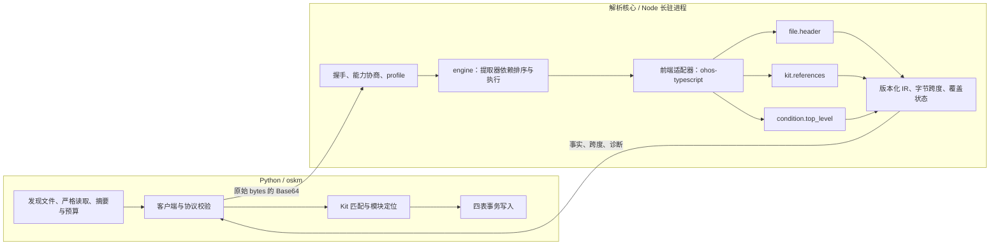

# ArkTS 解析核心详细设计

状态：**第一阶段已实现**。采集模型与四表见 [design.md](./design.md)，实测结果见
[validation.md](./validation.md)。

本文描述**源码如何被解析成事实**：进程边界、后端锁定、协议、提取器契约和扩展路径。
事实落到哪张表、关系怎么算，在 design.md。

---

## 1. 职责划分

Python 编排，Node 长驻进程内的 ohos-typescript 解析，二者通过版本化 IR 通信。



| 责任 | Python | Node |
|---|---|---|
| 路径、目录、后缀、允许根、文件预算 | 唯一负责 | **不自行打开源码路径或发现文件** |
| 原始读取、SHA-256、UTF-8 校验 | 负责；保留当次 bytes 供证据重建 | 校验传入 bytes/摘要后再严格解码 |
| 文件头与顶层引用语法 | 不另建正则解析器 | Scanner 处理头部，AST 处理 Kit 引用 |
| 条件注释及语句作用域 | 接收并验证结构 | 解释支持的条件，保留证据与未知状态 |
| Kit 身份、标签匹配、模块定位 | 唯一负责 | 不访问数据库、不猜目标 |
| 数据库、issues、分页、MCP | 唯一负责 | 不写任何采集产物 |

六条核心选择：

1. **模块只用 Scanner 读文件头。** 不对 1,517 份模块正文做完整 AST 分析——当前后端对
   部分静态 ArkTS 全文仍有语法诊断，让它影响归属采集是没必要的风险。
2. **Kit 用 `createSourceFile` 并显式 `ScriptKind.TS`。** 不依赖后缀自动切换语法，
   也不遇错就隐式换模式重试。
3. **一个 Node 进程处理一次 arkts 扫描。** 启动一次、串行处理，不为每个文件起进程，
   不引入 worker pool。
4. **只做语法分析。** 不创建 Program、不调类型检查、不 emit。任何阶段都不执行输入
   文件或打包裁剪脚本。
5. **后端失败显式报告。** 不自动回退标准 TypeScript、逐行正则或 Python 轻量解析——
   同一 schema 下隐藏解析行为变化比失败更糟。
6. **核心面向能力，采集器面向投射。** `module_kit_v1` 是首个配置，不把 module/kit
   写成核心仅有的两条永久分支；协议不暴露 TS 节点对象或 SyntaxKind 数值。

Python 主包仍只用标准库。**Node 与 ohos-typescript 是 arkts 独有的外部运行时依赖**，
仅在执行 arkts 扫描时加载；其他采集器的注册、扫描和查询都不要求安装 Node，
已生成的知识库也可以纯 Python 查询和导出。

---

## 2. 为什么是 ohos-typescript

曾比较过六类方案。选 C，并在实施中否掉了一度被推荐的 B：

| 方案 | 结论 |
|---|---|
| A 全文/逐行正则 | **否**。字符串、模板、API 示例里出现相同文本；多行 import 无法按行切分 |
| B Python 标准库轻量词法 | 一度推荐，**已否**。等于自研第二套入口语法解析器，支持矩阵要自己维护和验证 |
| C **ohos-typescript AST/Scanner** | **选用**。编译器已在工程内，节点分类与诊断可直接复用 |
| D tree-sitter | **否**。增加依赖与语法版本适配，未评测其 ArkTS 兼容性 |
| E 仓内现有 collect_api 等工具 | **否**。会引入构建环境与裁剪规则，改变"读取此源码树"的范围 |
| F 完整 ArkTS 编译器前端 | **否**。本阶段不需要类型语义，代价与收益不成比例 |

决定性证据：本地两套 TypeScript 在 50 份 Kit 入口上提取出**相同的 864 处引用、
0 个语法诊断**。同一批输入也证明了反例——`@arkts.lang.d.ets` 全文在 TS/ETS 两种模式下
**都有语法诊断**，所以模块侧才改用只读文件头的 Scanner 路径。

不采用把 TS AST 直接 JSON 化的做法：节点含父引用、后端内部字段和版本相关结构，体积大，
也表达不了属性的适用条件。公共模型用自有的带类型 JSON IR，Python 与 Node 各自校验、
共享版本化 schema。

未来若本地 OH TS 仍不支持目标静态语法，新增经过验证的前端适配器复用同一 IR。
**不能现在承诺任意新编译器可直接替换，也不能未经验证只改 `ScriptKind`。**

---

## 3. 依赖与版本锁定

| 项目 | 值 |
|---|---|
| Node | 工程内 v18.20.1（独立解析器另验证过 v20.19.2） |
| 包名 | ohos-typescript —— 目录名叫 typescript **不代表**标准 TypeScript |
| package version | 4.9.5-r10 |
| `ts.version` | 4.9.5，不能单独用于辨别 OH 分支 |
| 包根 | `interface/sdk-js/build-tools/node_modules/typescript` |
| 入口 | `lib/typescript.js` |

所有路径由 `--workspace-root` 拼接，不依赖 PATH，不增加 CLI 参数。

`node/backend-lock.json` 含 `protocol_version`、`adapter_version`、`node_versions`、
`package_name`、`package_version`、`entry_sha256` 及**完整包文件摘要清单**（102 项）。
Python 启动前逐项核对，Node 加载后再报告实际身份、入口路径和摘要，双向校验。

加载用显式绝对路径，不用会被父级 `node_modules` 改变的裸 `require('typescript')`。
启动时清除 `NODE_OPTIONS`、`NODE_PATH`，用 argv 数组而非 `shell=True`。adapter 用 `.cjs`
明确 CommonJS，不依赖外层 `package.json` 的 `type`。

运行时不执行 npm install、不联网。依赖缺失或不匹配返回 `BACKEND_UNAVAILABLE` /
`BACKEND_IDENTITY_MISMATCH`，**不提示"已降级成功"**。

> 入口 hash 只证明入口文件身份，不是完整依赖树的证明。开发环境用工作区包即可；
> 正式交付应提供匹配的离线包清单，不能只复制一个 `package.json` 冒充已锁定后端。

---

## 4. 文件组织与生命周期

```text
node/
├── bridge.cjs            JSON Lines 服务、握手、消息约束
├── profiles.cjs          profile → file_role → 能力清单
├── comments.cjs          注释原文与标签词法辅助
├── core/
│   ├── engine.cjs        profile 校验、提取器依赖排序与执行、coverage 汇总
│   ├── registry.cjs      提取器注册与能力声明、依赖拓扑
│   └── positions.cjs     UTF-16 → UTF-8 字节位置
├── frontends/
│   └── ohos_ts.cjs       唯一知道如何加载编译器的模块
├── extractors/
│   ├── header.cjs        file.header
│   ├── kit_refs.cjs      kit.references
│   └── conditions.cjs    condition.top_level
└── backend-lock.json
```

`core/` `frontends/` `extractors/` 不依赖 oskm 数据库、表名或 ctx，可在保持接口的前提下
独立打包。IR 校验分两处：Node 侧每个提取器自带 `validate`，Python 侧 `ir.py` 按 capability
注册校验器——**两边的扩展单位一致**，加一个事实各加一个函数加一条注册，没有单体分发函数。

扫描阶段：

1. 校验 `sdk_root` 与配置；发现并排序文件，预建 Kit 文件名身份。
2. 启动 Node，完成握手、包/adapter/IR 版本及 profile 所需能力校验。
3. Python 逐文件有界读取、摘要、严格解码；成功后发 parse 请求。
4. engine 按 `file_role` 选提取器；返回 IR 事实与逐能力覆盖状态；Python 校验消息、跨度、
   数量及证据边界，再投射到领域模型。
5. 全部结果收齐后执行 Kit 匹配和模块定位。
6. 关闭 Node；经 runner 单事务写入四表及问题。

一次只允许一个 in-flight parse，结果 id 必须与请求一致。AST 和 token 不跨文件缓存。

---

## 5. Python—Node 协议

### 5.1 编码

UTF-8 JSON Lines，每条消息一行以 LF 结束。源码用 **Base64 编码的原始文件 bytes** 传输，
避免 JSON 转义、BOM 或换行处理改变来源。Python 读取后严格 UTF-8 校验，Node 用
`TextDecoder('utf-8', {fatal:true, ignoreBOM:true})` 再解码并保留 BOM 字符以维持位置。
双重校验只增加约束，**不允许 Node 静默替换非法字节**。

请求路径用 SDK 相对 path，另带 `profile`、`file_role`、`byte_length`、`sha256`。
`profile` 是版本化解析目标，`file_role` 是输入角色，二者不与语言方言混为一谈。
Node 不回传整份源码，只回事实和跨度；Python 从当次原始 bytes 重建 `record`。

### 5.2 握手

```json
{
  "type": "ready", "protocol_version": 1,
  "ir_schema_version": "1.0.0", "adapter_version": "1.0.0",
  "node_version": "v18.20.1",
  "backend": {"package_name": "ohos-typescript", "package_version": "4.9.5-r10",
              "compiler_version": "4.9.5", "entry_sha256": "<实际入口摘要>"},
  "profiles": ["module_kit_v1"],
  "capabilities": [{"id": "file.header", "version": "1.0.0"},
                   {"id": "kit.references", "version": "1.0.0"},
                   {"id": "condition.top_level", "version": "1.0.0"},
                   {"id": "source.utf8_spans", "version": "1.0.0"}]
}
```

`node_version` 是实际运行版本，与锁定清单的**允许版本集合**核对。Python 校验 schema、
版本和能力后才发送文件。ready 只宣告**实际已实现**的能力。

### 5.3 parse 请求与响应

```json
{"type": "parse", "id": 17, "profile": "module_kit_v1", "file_role": "kit",
 "ir_schema_version": "1.0.0", "path": "kits/@kit.AbilityKit.d.ts",
 "byte_length": 18694, "sha256": "<当次摘要>", "content_b64": "<Base64 原始 bytes>"}
```

响应含 `coverage`（逐能力状态）、`facts`（按能力分区）、`diagnostics`、
`diagnostic_count`、`diagnostics_omitted`。所有 span 是 **UTF-8 bytes 半开区间**。

- tag：`name`、`value`、`evidence_state`、`span`
- reference：`statement_kind`、`specifier`、`target_span`、`statement_span`、`evidence_state`
- condition：`statement_span`、`condition_state`、`condition_evidence`

`facts` 按能力分区，各分区有专门 schema；**不能把任意键值对象当作已验证模型**。
未请求的能力不产生空事实分区。

diagnostic 统一含 `code`、`category`、`feature`、`extractor_id`、`message`、`span`（可空）、
`details`；TS 原始代码存 `details.ts_code`。没有定位时用空 span，**不伪造 `[0,0]`**。

正常关闭用 `{"type":"shutdown","id":N}`，Node 确认无在途文件后回 `{"type":"closed","id":N}`。
无法继续的内部错误输出受限 `{"type":"fatal","code":"..."}` 后非零退出；Python 将其归为
基础设施故障，**不转成单文件语法失败**。

### 5.4 校验

- 严格校验消息类型、版本、id、path、sha256；不接受重复 result、未知 id、日志行或不合 schema 的对象。
- 校验 `0 <= start <= end <= byte_length`，且端点落在 **UTF-8 字符边界**上。
- 证据原文由 Python 用跨度切片严格解码。`specifier` 是 TS 解码后的字符串值，
  不要求与含转义的原文字面量逐字相同。
- 结果数量和字符串长度有界；diagnostic 可按数量汇总，但**不能静默丢引用后仍返回 complete**。
- `profile` 必须属于已协商的内置集合，不能由源码内容或未知消息任意启用能力。

### 5.5 限额与背压

工程防护参数，不是性能承诺：

| 项目 | 默认 |
|---|---|
| 单文件输入 | 8 MiB，且不超过框架 `file_bytes` |
| 单行请求帧 / 响应帧 | 12 MiB / 4 MiB |
| 单条标签或 specifier | 16 KiB |
| 单文件引用数 | 20,000，且受框架 `tree_items` 总预算限制 |
| 单文件返回诊断 | 100 条样本，另带总数与省略数 |
| Node V8 heap | `--max-old-space-size=256`（heap 预算，不是 RSS 硬上限） |
| 启动 / 单文件等待 | 10 s / 15 s，可经 `request.options` 调整 |
| stderr 保留 | 256 KiB 环形尾缓冲，持续读取 |
| 域内证据总量 | 64 MiB，单片段 1 MiB |

Python 用非阻塞管道与 selector **同时**推进 stdin 写入、stdout 和 stderr 读取——
"先写完整个大帧再开始读"会让管道互相阻塞。Node 按字节限制行缓冲，不先无界累积到换行再检查。

单文件超时从开始发送该请求计至收到并校验完整响应，含传输时间，不只限制
`createSourceFile` 的调用时间。超时、协议损坏、进程异常退出视为基础设施故障，
终止本次采集，**不自动重启并换解析策略**。取消时关闭输入、终止子进程、短暂等待后强制回收；
Linux 用独立会话避免遗留进程，这些处理都在 `finally` 中。

---

## 6. 文件头：Scanner 路径

```javascript
ts.createScanner(ts.ScriptTarget.Latest, false /* 不跳过 trivia */,
                 ts.LanguageVariant.Standard, text)
```

从文件起始消费 BOM、空白、单行/多行注释、JSDoc 和 `'use static'` 指令及可选分号。
遇到首个实际声明或 import/export token 即停止，**后续正文不扫描、不建 AST**。

提取规则：

1. 只分析停止位置之前的 JSDoc，多段文件头均保留。
2. 注释内去掉每行展示用 `*`，按行首识别 `@file`/`@kit`；代码围栏中的示例标签不作事实。
3. 同一 JSDoc 含 `@file` 时其 `@kit` 为 `confirmed`；孤立 `@kit` 为 `candidate`，
   并产生 `ARKTS_TAG_WITHOUT_FILE`。
4. value 去首尾空白，保留内部空格和大小写；重复标签保留不同跨度，不覆盖。
5. 整个头部返回 span，标签分别返回精确证据 span。

不依赖 `ts.getJSDocTags()` 对首个声明的挂接结果判断文件归属——那会把声明注释与多段
文件头混在一起。

`header_status` 为 `ok`（读完且有 confirmed 标签）/ `no_tag`（读完且无归属候选）/
`partial`（只有孤立标签或头部结构问题）/ `failed`（IO、解码无法继续）。
**`no_tag` 与"文件打不开"因此不会混淆。**

`file_role=module` 时 `kit.references` 的覆盖状态为 `not_requested`，原样落在
`arkts_sources.coverage` 里——"没有分析正文"不写成 complete。
（曾另有一列 `references_status` 投射它，5.0.0 删除，因为它不携带 `coverage` 之外的信息。）

---

<a id="kit-refs"></a>

## 7. Kit 引用：AST 路径

```javascript
ts.createSourceFile(logicalPath, text, ts.ScriptTarget.Latest, true, ts.ScriptKind.TS)
```

保留原 `logicalPath`，不改文件名、不转换内容。显式 TS mode 是本次 Kit 验证过的契约，
**不代表把所有 ArkTS 声明都当作 TS**。

仅遍历 `sourceFile.statements`，不递归展开模块内部 API：

| 节点/形式 | 处理 |
|---|---|
| `ImportDeclaration` + 字符串 specifier | 一条 `import_from` 或 `side_effect_import`；**不输出导入名称列表** |
| `ExportDeclaration` + 字符串 specifier | 一条 `export_from`；具名、type、星号、命名空间转导出都以来源模块为单位 |
| `ExportDeclaration` 无 specifier | 不生成引用，不解析本地 export 绑定 |
| `ExportAssignment` | 不生成额外关系 |
| `'use static'`、`EmptyStatement` | 文件条件/空语句 |
| `ImportEqualsDeclaration` | `unsupported`，保留语句范围和诊断 |
| 顶层动态 `import()`/`require()` 等 | `unsupported`，入口状态 partial；不猜来源，不扫其中字符串造伪引用 |

支持的写法包括单/双引号、多行、注释插入、可省略分号；一条语句引用多个名称只计一条
模块来源证据。来源字符串用 AST 的 `moduleSpecifier.text`（由编译器解释转义），
原始字面量和整条语句通过 span 保留。

**语法诊断策略：文件级拒收。** 只要 `parseDiagnostics` 非空，该 Kit 入口的
`coverage['kit.references']` 即为 `failed`，不把错误恢复 AST 中的任何引用当作 confirmed 关系写库。
已独立读到的头部与来源记录保留，问题附原始 TS code 和转换后的字节位置，继续其他文件。

这比逐节点猜测诊断影响范围更易验证。若未来确需部分接受，需新增独立策略与测试，
不能偷偷改变当前行为。该策略属于 `kit.references` 提取器，**不固化为核心对所有能力的统一策略**。

语法失败、支持范围不足（partial）、目标定位失败是三种不同状态。

---

## 8. 条件提取

`/*** if arkts static */` 对 AST 只是注释，提取到 import 不会自动带上条件，所以需要在
**源码位置**上独立解释，再回接引用。

不能用全文正则抓标记：字符串、模板文本或 API 示例里可能出现相同字符。也不能只跑
无上下文 Scanner 就认为所有注释都识别正确——模板插值和正则字面量需要解析上下文。

对语法诊断为零的 Kit，按顶层 statements 排序构造 AST 确认的语句间区间：

```text
[0, first.getStart(sf))    [stmt[i].end, stmt[i+1].getStart(sf))    [last.end, text.length)
```

用 `skipTrivia=false` 的 Scanner 扫描这些区间，识别真实多行注释，再判断其完整文本是否为
专用条件标记。节点跨度先以 UTF-16 表示，最终统一转为 bytes。

已识别的 import/export 语句**内部**也检查标记，以发现条件穿越语句的问题：若语句内部存在
if/endif，报 `CONDITION_CROSSES_STATEMENT`，该语句条件为 `unknown`，
**不把一条语句按文本切成多个分支**。其他不透明声明块内部的注释不参与顶层关系条件。

状态机支持 `if arkts dynamic|static|dynamic&static` 与 `endif`，用候选集合加显式证据标志
表示。节点起始位置落在哪些有效区间就继承其交集；文件后缀、文件指令与块条件合并时
**不能扩大集合**，空交集变 `unknown` 但不删除原始关系。

未知 `if` 也入栈，配对 `endif` 后恢复外层。`else`/`elif` 本期不解释为反集，相关块变
`unknown`。EOF 未闭合、多余 `endif`、条件跨节点边界均有诊断，并**回标**受影响的引用——
不能因为引用先提取就留下错误的确定状态。

本能力只声明为 `condition.top_level`。后续声明/成员内部条件需要前端提供有语法上下文的
注释和节点边界，**不能复用顶层间隙结果就宣称覆盖所有成员条件**。

---

## 9. 位置与原文保真

| 单位 | 用途 |
|---|---|
| UTF-16 code unit offset | TypeScript Scanner/AST 的内部位置 |
| UTF-8 byte offset | 协议、存储、原始文件切片；统一半开区间 |
| 1-based 行号 + Unicode 码点列号 | 面向使用者的定位展示 |

三者不混用。`getLineAndCharacterOfPosition` 的 `character` 是 UTF-16 character，
**不能直接当码点列**。

转换方法：收集该文件需导出的全部 UTF-16 端点，排序去重，单次遍历字符串按码点累计
UTF-16 长度与 UTF-8 字节长度，在端点处记录映射。避免为每个 span 重复编码整个前缀。

- 非 BMP 字符占两个 UTF-16 code unit、UTF-8 通常四字节；端点落在代理对中间时**拒绝结果**
- BOM 原样保留，占三字节、一个 UTF-16 code unit；首行展示列不计 BOM
- CRLF 按一个换行计算，原文字节不改写；同时处理 LF、单 CR 和 U+2028/U+2029
- 列按码点数计算，tab 计一个码点，不按终端显示宽度展开

Python 接收后再次验证边界，并从原始 bytes 切出证据。后端不使用 printer 重建原文；
SHA-256 始终对原始 bytes 求值。

---

<a id="extensibility"></a>

## 10. 扩展契约

### 10.1 分层接口

| 层 | 契约 | 禁止耦合 |
|---|---|---|
| SourceInput | 相对路径、原始 bytes、sha256、文件角色、受控配置 | 不依赖数据库行号或产品安装路径 |
| FrontendAdapter | 声明能力矩阵；提供头部扫描、语法树句柄、注释范围与诊断 | 不建立 Kit/部件关联，不把编译器节点输出到协议 |
| Extractor | 读取前端上下文及已声明依赖的结果；输出自己命名空间内的事实、诊断和覆盖率 | 不读文件、不联网、不写库，不隐式调用其他提取器 |
| Engine | 校验 profile，依赖拓扑排序，共享单次解析上下文，汇总 IR | 不按 API 类名或 Kit 名硬编码业务分支 |
| Projection | 把 IR 映射到 oskm 领域记录 | 不绕过 IR 读 TS Node，不用正则补造语法事实 |

提取器的最小描述是 `id / version / requires / validate / run`。依赖缺失、成环、
同一能力有多个提供者，都在处理文件**之前**失败。profile 确定顺序和实现版本，
不依赖注册的偶然顺序。需要 AST 的多个提取器共享一次 parse，模块头部路径不强制建 AST。

### 10.2 Profile 与能力矩阵

| Profile / file_role | 请求的能力 | 解析方式 | 阶段 |
|---|---|---|---|
| `module_kit_v1` / `module` | `file.header`、`source.utf8_spans` | Scanner，仅文件头 | **已实现** |
| `module_kit_v1` / `kit` | 上述 + `kit.references`、`condition.top_level` | Scanner + 显式 TS AST | **已实现** |
| `api_structure_v1` | `api.declarations`、`api.signatures`、`api.type_syntax`、`doc.blocks`、`doc.tags`、`condition.scoped` | 经方言验证的全文 AST | 规划 P2 |
| `api_semantics_v1` | 上述 + `api.symbols`、`api.resolved_types`、`api.export_bindings` | 受控项目上下文 | 规划 P3 |

**写进设计的未来能力名不等于现在可以请求。** ready 只宣告已实现的。

`file.header` 的 `complete` 只表示文件头规则完整执行，不表示正文语法被支持；
Kit TS AST 的成功也不外推到所有 `.d.ets`。

### 10.3 覆盖状态

| `coverage.status` | 含义 |
|---|---|
| `complete` | 在该能力版本声明的输入范围内完整执行；允许合法零结果 |
| `partial` | 只接受部分可靠事实，附遗漏区域与可测量计数 |
| `not_requested` | profile 未请求；**不得据此回答"没有该 API/属性"** |
| `unsupported` | 请求已知，但该前端/方言不具备此能力 |
| `failed` | 输入、解析或提取失败；不给出该范围的确定事实 |

coverage 覆盖 profile 的全部能力，包括按角色未启用的（如 module 的 `kit.references`）。
字节跨度验证成功**不能抬高语义覆盖率**。

属性事实另有 `declared/absent/unknown`，关系另有 `resolved/unresolved/ambiguous`——
不把这些状态压进一个布尔 success。`absent` 仅表示完整检查的范围内未出现该属性，
`not_requested`/`failed` **不能投射成 `absent`**。

### 10.4 版本维度

协议版本管消息形状，IR 版本管事实语义，profile/提取器版本管算法与范围，
前端版本管编译器能力，数据库 schema 管投射。未知必需能力、未知必需 fact 类型或
不兼容主版本一律拒绝；可忽略的附加字段必须在 schema 里显式标为可选，
**禁止"任意未知字段都忽略"的宽松反序列化**。

单请求/单响应是当前形状。若未来响应超过 4 MiB，新增协商能力 `result.chunks`
（begin/chunk/end、递增序号、总计数、内容摘要），未协商时仍按现有限额失败，
不偷偷输出多行 result。

### 10.5 已验证的扩展契约

| 编号 | 场景 | 预期 |
|---|---|---|
| E-01 | 测试注册表中加入独立样例提取器和 schema | 只增加自身实现/注册/profile/schema；bridge、位置系统、四表投射不需加业务分支 |
| E-02 | 未知 profile、必需能力缺失、依赖环、重复提供者、不兼容 IR | 处理文件前明确失败，不降级成功 |
| E-03 | 模块角色扫描正文含静态语法/函数/权限标签 | 仍只扫头部；正文能力为未请求，不生成 API 实体也不暗示属性缺失 |
| E-04 | Kit AST 失败但头部成功；局部能力 unsupported/partial | 分区状态与诊断可区分；拒收失败引用，可靠头部保留 |
| E-05 | 升后端/profile/提取器版本，源码不变 | `input_digest` 改变；旧快照查询不要求运行新后端 |
| E-06 | 不认识的可选字段、未知必需事实、错误 span/hash | 严格执行 schema 与证据校验，不静默产生确定关系 |

验证记录见 [validation.md](./validation.md)。

---

## 11. 后续阶段的中间模型

P2 起的目标是完整保留目标 SDK 版本所表达的 API 结构、类型、文档属性、条件与来源。
"完整"必须相对于**明确的语言版本、属性目录和覆盖率验证**，不能等同于跑一次 AST 遍历，
也不能把声明文件未提供的运行时行为推断成事实。

| 模型 | 语义 | 阶段 |
|---|---|---|
| SourceFile / Evidence | 已有：source_key、content_sha256、byte_span、coverage | 已实现 |
| DeclarationOccurrence | `(source_key, content_sha256, byte_span, kind)` 摘要；同名重载、不同语言变体、声明合并各自独立 | P2 |
| Signature / TypeExpr | 重载序号、类型参数、参数序列、返回类型；命名引用有独立未解析状态 | P2 |
| DocBlock / TagOccurrence | 注释与标签的原始范围、顺序、多行和重复出现 | P2 |
| AttributeAssertion | 属性名、值、版本/方言条件、evidence_refs、解释器版本 | P2/P3 |
| Symbol / ExportBinding | 声明集合、外部名称/别名、目标候选与解析状态 | P3 |
| EffectiveAttribute | 生效条件、来源断言、继承/合并规则、冲突、规则版本 | P3 |

三条必须守住的规则：

1. **原始声明、解释值、有效值分离。** `@since 12 dynamic` 与 `@since 13 static` 是两次
   TagOccurrence、两个有条件的版本断言，**不能覆盖成单个 `since=13`**。没有匹配规则的值
   保留 `raw_value` 与 unknown，不猜成最低版本。
2. **Symbol 不能由"同名"构造。** 它是语义归并结果。Kit 对文件的 entry_reference、
   模块的导出绑定、最终可导入符号是三类关系。
3. **父级属性是否可继承由逐属性规则决定。** 文件头 `@kit` 不自动传播成每个 API 的
   可用性属性；父子冲突保留双方证据，不统一"子覆盖父"。

未知标签必须保留原文和顺序并计数。"原文采集完整"与"属性解释完整"**分开计量**。

P1 数据库不存正文，因此**无法离线还原未采集的 API**：后续升级必须重新读取摘要相同的
源码快照；源码已变就建新扫描，不在旧 scan 上悄悄补入新版本正文。

---

## 12. 本地依据

- 后端：[package.json](../../../../../../../interface/sdk-js/build-tools/node_modules/typescript/package.json)、
  [类型声明](../../../../../../../interface/sdk-js/build-tools/node_modules/typescript/lib/typescript.d.ts)、
  [实现入口](../../../../../../../interface/sdk-js/build-tools/node_modules/typescript/lib/typescript.js)
  （依赖当前工作区已安装包，正式分发由锁定清单替代机器路径）
- 样本：[ArkTS lang](../../../../../../../interface/sdk-js/arkts/@arkts.lang.d.ets)、
  [ArkUI static](../../../../../../../interface/sdk-js/kits/@kit.ArkUI.static.d.ets)、
  [DrmKit](../../../../../../../interface/sdk-js/kits/@kit.DrmKit.d.ts)、
  [index](../../../../../../../interface/sdk-js/api/@internal/ets/index.d.ts)
- 框架：[framework.py](../../core/framework.py)、[runner.py](../../core/runner.py)、
  [有界读取](../../core/io.py)
