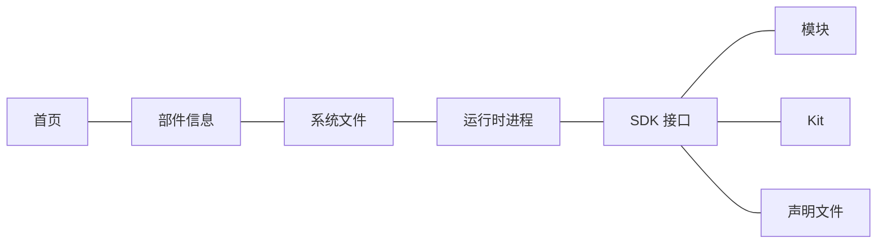
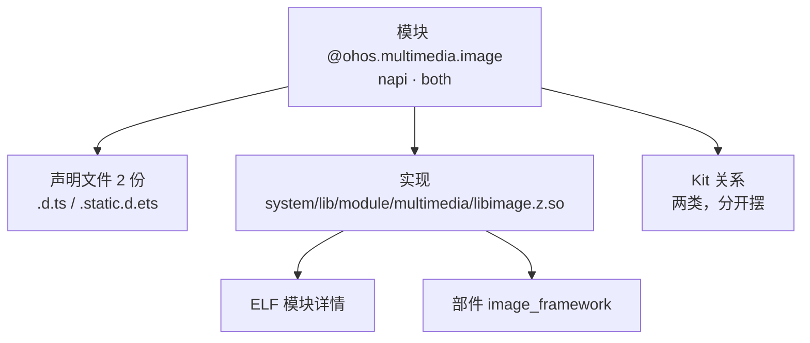
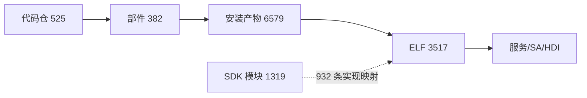

# Viewer：ArkTS（SDK 接口）视图详细设计

日期：2026-10-25
状态：**设计方案，未实现。**
数据模型见 [采集侧 design.md](../../oskm/collectors/arkts/design.md)，
现有 viewer 约定见 [ux-design.md](./ux-design.md)、[url-spec.md](./url-spec.md)。

---

## 1. 前提：两个必须先解决的事实

### 1.1 当前 viewer 数据库里没有 arkts 表

`viewer/public/knowledge.db` 共 **17 张表，`arkts_*` 一张都没有**——它是 arkts 落库之前
生成的快照。实现本设计前必须用当前采集器重新生成 artifact，否则所有新视图都是空的。

### 1.2 旧库打开会"空列表冒充没有数据"

`useDatabase.rawQuery()` 捕获异常后返回 `[]` 并只 `console.warn`。因此对一个没有
`arkts_*` 的旧快照，新列表页会渲染成**一个正常的空表格**——看起来像"这个产品没有
SDK 模块"，而事实是"这个库没采过"。

这正是采集侧明确拒绝过的模式（`COLLECTOR_NOT_RUN` 而不是空清单）。所以本设计的
**第一项改动不是加视图，而是加能力门控**：

```js
// nav.js：菜单项声明它依赖哪张表
{ route: '/sdk/modules', label: '模块', table: 'arkts_modules', needsTable: 'arkts_modules' }

// stores/viewer.js：开库时读一次 sqlite_master，存成 Set
store.tables.has('arkts_modules')
```

- 菜单项：表不存在时置灰（复用 `needsDb` 已有的 `muted` 样式），不隐藏——
  隐藏会让使用者以为这个功能不存在。
- 视图本体：渲染一条明确说明「**本快照未采集 arkts**，请用当前版本重新扫描」，
  不渲染空表格。

这条门控对将来任何新域都适用，不是 arkts 专用补丁。

---

## 2. 要回答的问题

| 编号 | 问题 | 落在哪 |
|---|---|---|
| V-01 | SDK 有哪些 Kit，各自关联多少模块 | Kit 列表 |
| V-02 | `@ohos.multimedia.image` 属于哪个 Kit、由哪个 .so 实现、声明在哪几个文件 | 模块详情 |
| V-03 | 哪些模块没有 Kit 归属 / 实现方式未知 | 模块列表筛选 |
| V-04 | 哪些声明文件读取失败 | 声明文件列表筛选 |
| V-05 | `libimage.z.so` 实现了哪些 SDK 模块 | **ELF 详情页反向区** |
| V-06 | 某个部件对外提供了哪些 SDK 模块 | 部件详情页反向区 |
| V-07 | ArkTS 采集完整吗、有哪些问题 | 质量页 + 首页体检带 |

V-05/V-06 是本次实现映射带来的**新能力**，也是 arkts 第一次与产品面连通——
设计上要显式照顾，不能只做三个孤立列表。

---

## 3. 导航：第四个一级组



```js
{
  key: 'sdk', label: 'SDK 接口', icon: 'node', needsDb: true,
  children: [
    { route: '/sdk/modules',      label: '模块',     table: 'arkts_modules',  needsTable: 'arkts_modules' },
    { route: '/sdk/kits',         label: 'Kit',      table: 'arkts_kits',     needsTable: 'arkts_kits' },
    { route: '/sdk/declarations', label: '声明文件', table: 'arkts_sources',  needsTable: 'arkts_sources' },
  ],
}
```

**为什么是第四组而不是塞进「部件信息」**：现有三组描述的是*这个产品构建出了什么*
（源码 → 镜像 → 进程）。SDK 声明描述的是*应用开发者看到的接口面*，它不随产品裁剪
而变——`scans.product` 不影响模块清单。混进「部件信息」会让"382 个部件"和
"1319 个模块"看起来是同一层的东西。

`groupOf()` 已按子项的 `table` 属性反查分组，所以 `/e/arkts_modules/:id`
这类实体页会自动归到新组，不需要额外代码。

---

## 4. 三个列表视图

全部复用 `EntityTable`（搜索 / 任意列排序 / 分页 / 列选择 / 导出 / ⓘ 字段说明），
每个视图约 20 行 `.vue` + 一个列目录，与现有 10 个列表完全同构。

### 4.1 `/sdk/modules` 模块（1,319 行）

| 列 | 分组 | 说明要点 |
|---|---|---|
| `module_key` | 身份 | 主列，**去语言后缀**的 SDK 相对路径 |
| `module_name` | 身份 | 可 import 名；676 个为空，注明"只能相对路径引用" |
| `declaration_scope` | 身份 | 声明在哪（路径事实） |
| `implementation_kind` | 实现 | 怎么实现；**空值与 unknown 不同**，详见 §7 |
| `so_path` / `installed_at` | 实现 | 声明路径 / 镜像内实际位置（链接到 ELF 详情） |
| `component` | 实现 | 实现它的 .so 所属部件（链接到部件详情） |
| `language_coverage` | 语言 | dynamic / static / both |
| `files` | 声明 | 声明文件数（1 或 2） |
| `kits` | 归属 | 去重 Kit 数 |

默认显示：`module_key`、`module_name`、`implementation_kind`、`installed_at`、`kits`。
默认排序 `module_key`。

**`implementation_kind` 的筛选是这个视图的主要价值**：一键看出 525 个 NAPI 模块、
407 个 ArkUI 模块、108 个实现未知。

### 4.2 `/sdk/kits` Kit（51 行）

| 列 | 说明 |
|---|---|
| `kit_key` | 主列。`@kit.X` 或 `label:X` |
| `name` / `import_name` | 展示名 / 可 import 名（label_only 为空） |
| `origin` | entry_backed(49) / label_only(2) |
| `entries` | 入口声明文件数 |
| `modules` | 去重关联模块数 |
| `mentioned_in` | **label_only 专用**：提及它的模块文件数 |

`mentioned_in` 是为了填上采集侧已识别的表达缺口：label_only 的 Kit **没有定义文件**，
`entries` 恒为 0，若不另给一列，使用者看到的就是一个空白行。
取数见 §6.3。

### 4.3 `/sdk/declarations` 声明文件（1,567 行）

| 列 | 说明 |
|---|---|
| `source_path` | 主列，workspace 相对路径；带 git 链接（复用 `gitlink.js` 的通用文件链接规则，与 NDK 头文件一致） |
| `role` | 模块声明(1,517) / Kit 入口(50)，列表顶部给一键分面 |
| `module_key` / `kit_key` | 它声明的实体，链接过去 |
| `declaration_format` / `language_variant` | d.ts / d.ets / static.d.ets；dynamic / static |
| `read_status` / `header_status` | 读取与文件头状态 |
| `byte_size` | 观测值 |

`read_status != 'ok'` 的筛选直接回答 V-04（当前 1 条非 UTF-8）。

**`napi-map.json` 不在这张表里。** 本文初稿设想用一个 `kind` 列把它收进来当"一等公民"，
实施时否了：它是采集器自带的参考数据，不是 sdk-js 仓里的声明文件，混进"声明文件"列表
会让使用者以为它能在源码树里找到。它的摘要记在 `collector_runs.scope.napi_map`。

**默认按 `source_path` 排序时首页"所属 Kit"整列为空**，看着像坏了其实是对的——
1,567 份里只有 50 份是 Kit 入口，按路径排全落在最后一页。顶部的角色分面就是为了
把这层结构摆到明面上。

---

## 5. 详情页

三个实体各有一个定制整页，**都不走抽屉**：抽屉摊不开"声明路径 vs 镜像实际位置"
这种必须并排看的内容，也摊不开逐条带行列与原文的证据表。
路由在通用 `/e/:table/:id` 之前匹配：

| 路径 | 组件 |
|---|---|
| `/e/arkts_modules/:id` | `ModuleDetail.vue` |
| `/e/arkts_kits/:id` | `KitDetail.vue` |
| `/e/arkts_sources/:id` | `SourceDetail.vue` |

外壳（面包屑 → 头部 → tab 栏 → 卡片）抽在 `styles/detail-view.css`，
与 `list-view.css` 同一个角色。三个页面长得一样不是巧合，是同一张样式表。
`ComponentDetail.vue` 不引用它——它有自己的一套（饼图、产物行、下划线式 tab），
改它风险大于收益；`.cd-*` 命名刻意保持一致，所以两边看起来是同一个产品。

### 5.0 版式约定（照部件详情页）

1. **每个字段名底下压一行小字**说明它是什么（`dt > .hint`）。
   详情页的价值一半在这行小字上——列名自己说不清楚的事，在这里说。
2. **表头用 `ⓘ`** 挂放不下的解释（`th > .q[title]`），与部件详情页同一个做法。
3. **枚举值翻成人话**，并解释"空/未知"意味着什么。这个域里空值有好几种完全不同的
   来源，混成一个空白单元格就等于把"查不到"和"没有"说成一回事。
4. **空 tab 灰掉而不是藏起来**：藏起来会让人以为这个实体没有这一类信息，
   灰掉才说明"有这一类，但这个实体是 0 条"。
5. tab 进 URL（`?tab=`），刷新、贴链接、后退都回到同一处。

### 5.1 模块详情 `/e/arkts_modules/:id`



四个 tab：

| tab | 内容 | 关键点 |
|---|---|---|
| 基本信息 | 模块键 / 可 import 名 / 声明位置 / 语言版本 + 一眼概览 | 676 个模块没有 import 名，页面要明说**空不是采集遗漏** |
| 实现 | 实现方式 / 匹配方式 / 运行时名 / 实现库 / 实现部件 | `impl_so_path` 与 `installed_at` **并排**；两者都按扫描 `cpu_arch` 使用 `system/lib` 或 `system/lib64`，新库中应相同 |
| 声明文件 | 每份一行，带语言版本、后缀、适用模式、读取状态、git 链接 | 双声明模块这里是两行——2.0.0 重建模要让人看见的正是这个 |
| Kit 关系 | 自己声明的归属 / 被 Kit 入口引用，**两张表** | 见下 |

**Kit 关系必须分两张表，不能合并成"所属 Kit"。**
`declared_membership` 是模块在自己文件头写的 `@kit` 标签，
`entry_reference` 是某个 Kit 入口把它 import 了进去。两者会不一致，而且不一致是正常的。
合并显示就把"谁说的"这个关键信息抹掉了。页面顶部直接给出差集数量。

`match_method` 的 7 条 `name_suffix` 要能一眼认出是兜底匹配——翻成
「名字后缀唯一匹配 · 证据比前两种弱，看到要留心」。

`entities.js` 登记：

```js
arkts_modules: {
  label: 'SDK 模块', icon: 'node', accent: 'component',
  title: r => r.module_name || r.module_key, subtitle: r => r.module_key,
},
arkts_kits:    { label: 'Kit', icon: 'box', accent: 'component',
                 title: r => r.name, subtitle: r => r.import_name || r.kit_key },
arkts_sources: { label: '声明文件', icon: 'node', accent: 'component',
                 title: r => r.source_path, parent: 'module_id' },
```

实现映射**不是独立实体**——schema 6.0.0 把 `arkts_module_impls` 折叠成
`arkts_modules` 上的 `impl_*` 四列（实测严格一对一），所以没有对应的 `ENTITIES` 条目，
实现信息直接长在模块详情页上。

`parent: 'module_id'` 是必须的：`arkts_sources` 的出边有 `module_id` 与 `kit_id`，
面包屑默认取第一条外键；若按 `kit_id` 走，1,517 份模块声明的面包屑会全部断掉。

> `icon` 只能取 viewer 已注册的那几个（home/runtime/build/image/search/tools/
> shield/chip/box/node/arrow/…）。本文初稿写的 `'file'` 不存在，渲染出来是空白。

### 5.2 Kit 详情 `/e/arkts_kits/:id`

四个 tab：基本信息 / 入口文件（label_only 时换成"被提及的文件"）/ 成员模块 / 引用证据。

**这一页的主要工作是把两条成员来路摆开。** 基本信息页直接给四个数字：

| 指标 | AbilityKit 实测 |
|---|---:|
| 成员模块合计（并集） | 235 |
| 两边都有 | 104 |
| 仅有标签（入口没 import） | 131 |
| 仅被引用（模块没写标签） | 0 |

成员表每行带一个"来路"标记（两者 / 仅标签 / 仅引用）。
后两类**不是数据缺陷**——标签是模块的自我声明，import 是入口的实际组成。

**引用条数 ≠ 模块数**：AbilityKit 的 188 条引用只指向 104 个模块，
因为同一个模块常在 `if arkts static` 和 `dynamic` 两个分支里各 import 一次。
页面上写明这一点，否则 188 会被当成成员数。

`label_only`：**不渲染空的"入口文件"区**，改渲染"提及它的 N 份模块文件"，
并写明「该分组没有 Kit 入口，它只出现在模块的 `@kit` 标签里」。

### 5.3 体量

最大的 Kit 是 ArkUI（505 个成员模块 + 147 条引用）。表用 `v-show` 切 tab，
所以两张表总是同时渲染，共 654 行——实测冷启动 1,233 ms（含 sql.js 启动与
建库），热态 55 ms。不分页。

---

## 6. 取数与性能

### 6.1 `scan_id` 纪律（再次实测）

相关子查询必须把 `scan_id` 一起写进 `WHERE`，否则 planner 无法 seek 以 `scan_id`
打头的索引。模块列表实测（sqlite3，1,319 行）：

| 写法 | 耗时 |
|---|---:|
| 子查询带 `s.scan_id = m.scan_id` | **7.7 ms** |
| 子查询只写外键 | **456.5 ms** |

**59 倍**。这与 `lists.js` 开头记录的部件列表 264 ms → 9.2 ms 是同一个坑，
新表同样踩得到。sql.js 比本地 sqlite3 还要慢 3–10 倍。

### 6.2 各视图实测取数耗时

| 视图 | 行数 | sqlite3 |
|---|---:|---:|
| 模块列表 | 1,319 | 7.7 ms |
| Kit 列表 | 51 | 0.4 ms |
| 声明文件列表 | 1,568 | 5.3 ms |
| ELF 反向聚合 | 526 | 0.6 ms |

最大的 1,568 行远小于现有 `install_modules` 的 5,501 行，`EntityTable` 的分页已经
验证过那个量级，**不需要新的性能手段**。

### 6.3 `mentioned_in` 的取数

```sql
SELECT k.id, COUNT(DISTINCT r.source_id) AS mentioned_in
  FROM arkts_kits k
  JOIN arkts_kit_relations r ON r.scan_id = k.scan_id AND r.kit_id = k.id
 WHERE k.scan_id = ?
   AND NOT EXISTS (SELECT 1 FROM arkts_sources s
                    WHERE s.scan_id = k.scan_id AND s.kit_id = k.id)
 GROUP BY k.id
```

只对没有入口文件的 Kit 计算，有入口的留空——两种 Kit 的"来源"含义不同，
不该合并成一个数字。

---

## 7. 空值的三种含义，必须分开显示

这是本视图最容易做错的地方。`implementation_kind` 与实现行的组合有三种状态：

| 状态 | 数据表现 | 应当显示 |
|---|---|---|
| 有已解析的实现 | 有 impl 行，`elf_module_id` 非空 | 路径 + 链接到 ELF |
| 声明了实现，但不在本产品镜像 | 有 impl 行，`elf_module_id` 为空 | 「声明于 `<path>`，本镜像未安装」 |
| 不知道由谁实现 | **没有 impl 行**，kind=`unknown` | 「实现未知」 |
| 本就无需实现 | 没有 impl 行，kind=`type_only` | 「纯类型声明」 |

四者都渲染成空白单元格，等于把"查不到"和"没有"混为一谈。
rk3568 上第二种当前为 0 条，但列必须能表达它——否则换个产品就会误导。

---

## 8. 与产品面的反向连接

这是实现映射真正的价值，**不能只做 SDK 侧三个列表就收工**。

### 8.1 ELF 详情页新增区块（V-05）

```sql
SELECT m.id, m.module_key, m.module_name, m.implementation_kind, m.impl_match
  FROM arkts_modules m
 WHERE m.scan_id = ? AND m.impl_elf_id = ?
 ORDER BY m.module_key
```

`libace_engine_pa_ark.z.so` 会列出 **407 个** ArkUI 模块——这一区必须默认折叠并分页，
否则会把 ELF 详情页压垮。其余 .so 多为 1 个。

### 8.2 部件详情页新增一行（V-06）

部件 → 它的 ELF → 实现的 SDK 模块数。放进现有统计区，链接到模块列表的筛选态。

### 8.3 首页流程图接第四段

现有三段是 `代码仓 → 部件 → 安装产物/ELF → 运行时`。SDK 不是这条链的下一环，
而是**从侧面接到 ELF 上**：



虚线表达的正是"声明面与实现面在这里对上"。`overview.js` 补四个计数：
`arktsModules`、`arktsKits`、`arktsImplResolved`、`arktsImplUnknown`。

---

## 9. 质量页

`issues.js` 补三个码的人话解释（照采集器源码写，不猜）：

| code | 解释要点 |
|---|---|
| `ARKTS_NAPI_MODULE_UNMATCHED` | 映射表里的运行时名在 SDK 中找不到对应模块。`details.by_reason` 已按 `no_module`(60) / `ambiguous_suffix`(1) 分组，解释要说明前者多为"有实现无公开声明" |
| `ARKTS_IMPL_SO_AMBIGUOUS` | 按 `cpu_arch` 构造的 .so 路径在镜像中命中多个 ELF 行，未回填链接 |
| `ARKTS_IMPL_SO_MISSING` | 按 `cpu_arch` 构造的 .so 路径不在本产品镜像里 |

另有既有的 `ARKTS_READ_*`、`ARKTS_LINK_*`、`ARKTS_ENTRY_NAME_INVALID`、
`ARKTS_TAG_WITHOUT_FILE`、`ARKTS_KIT_NAME_CONFLICT` 需要补齐。

---

## 10. 分期与验收

| 期 | 内容 | 验收 |
|---|---|---|
| 一 | 能力门控（`needsTable` + 未采集提示）+ 重新生成 artifact | 用旧库打开菜单置灰、视图给出明确说明而非空表 |
| 二 | 三个列表视图 + 列目录 | `npm run table` 覆盖新视图的排序/筛选/导出 |
| 三 | `entities.js` 登记 + 两个详情页定制 | `npm run nav` 覆盖列表↔详情往返与面包屑 |
| 四 | 反向区块（ELF / 部件）+ 首页第四段 | `npm run menu`、`npm run shoot` |
| 五 | 质量页解释 | 人工核对每条解释与采集器源码一致 |

每期都要跑 `npm run verify`（smoke / menu / nav / table / a11y 双主题 / perf / shoot）。
**a11y 必须双主题跑**：本项目已经三次在"颜色叠在 surface 上对比度不足"上栽过，
新增的 `accent` 用色要走既有变量，不要新造。

---

## 11. 不做的事

- **不做 API 成员级视图。** 采集侧 P2 未实现，没有数据。
- **不在前端做模块↔.so 匹配。** 匹配是扫描时确定的事实，前端只展示 `match_method`。
- **不把 `arkts_kit_relations` 做成列表视图。** 2,321 条证据是详情页的内容，
  单独成列表没有使用场景。
- **不给 ArkUI 的 407 个模块编造各自的 .so。** 它们共享引擎，这是事实，
  视图如实显示同一个路径即可。
- **不隐藏 label_only 的 Kit。** 它们是真实的源码分类，只是没有入口。
